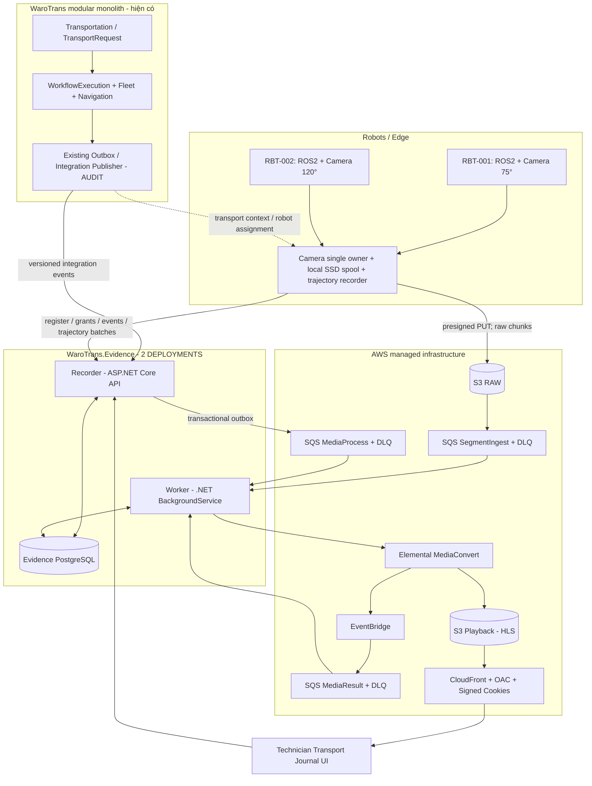
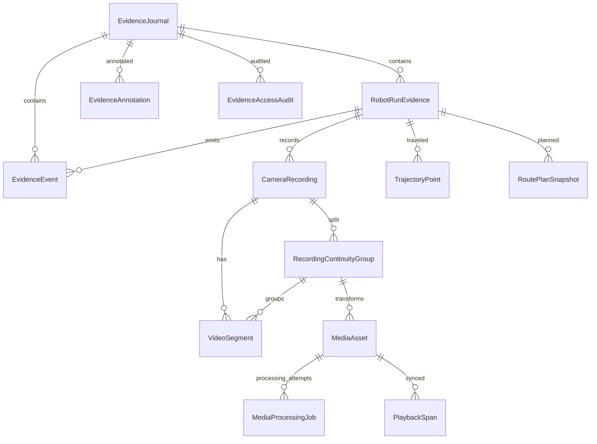
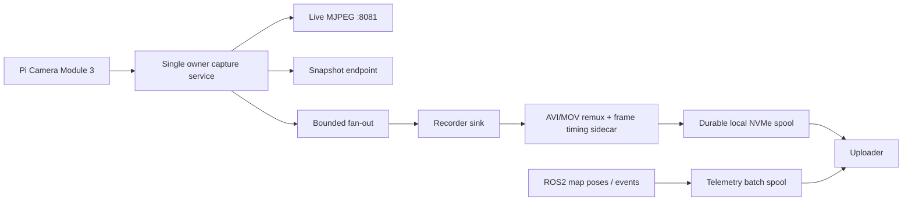
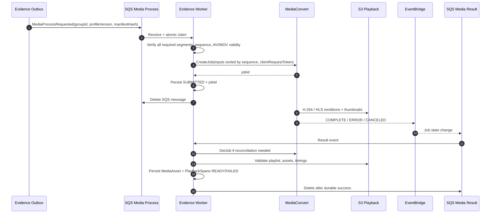

# WAROTRANS — TRANSPORT EVIDENCE, RECORDER & MEDIA WORKER

**Tài liệu thiết kế hệ thống và đặc tả triển khai cho Claude Code**  
**Ngôn ngữ:** Tiếng Việt · **Phiên bản:** 1.0 · **Ngày:** 17/11/2026  
**Phạm vi:** Transport Journal, multi-robot journey replay, camera recording, AWS S3/SQS/MediaConvert/CloudFront, Technician UI  
**Cấu trúc đã được người dùng chọn:** `backend/src/WaroTrans.Evidence/Recorder` và `backend/src/WaroTrans.Evidence/Worker`; **hai .NET project, hai deployment/process độc lập; sử dụng Vertical Slice Architecture (VSA), KHÔNG yêu cầu Clean Architecture**.

> **QUAN TRỌNG — Mức độ xác minh.** Tài liệu này là **target architecture/specification**, KHÔNG phải bản audit source code. Từ ảnh và trao đổi, đã biết backend là modular monolith với các module như `Transportation`, `WorkflowExecution`, `Fleet`, `Navigation`, có cây VSA `Contracts`, `Entities`, `Enums`, `Features`, `Persistence`, `Services`; user đã tạo `WaroTrans.Evidence/Recorder` và `Worker`. Các tên/enum/status, kiểu khóa và quan hệ **hiện có bên Transport/Job/Assignment chưa được mở source để xác minh**. Tuyệt đối **không tự tạo hoặc đổi status/entity cũ** dựa trên ví dụ trong tài liệu. Phần được ghi **[NEW]** là thuộc sở hữu Evidence nên được phép bổ sung. Phần **[AUDIT]** phải lấy đúng từ repository thực tế trước khi code. Nếu mô hình hiện có dùng `TransportRequest → Workflow → Job → JobTask/JobStep → JobAssignment`, hãy tích hợp theo các entity hiện có; **không được mặc định `TransportExecution` hoặc `RobotRun` là entity đã tồn tại**.

---

## 0. Kết luận kiến trúc (Architecture Decision Record)

| Quyết định | Chốt | Tại sao |
|---|---|---|
| Business Transport/Fleet | Giữ tại modular monolith hiện tại | Không tạo nguồn dữ liệu nghiệp vụ thứ hai, không rewrite dispatch |
| Evidence/Recorder | `.NET Web API project`, triển khai riêng | Sở hữu Journal, recording metadata, API, auth, query, upload grants |
| Evidence/Worker | `.NET Worker project`, triển khai riêng | Xử lý queue, validation, aggregation, MediaConvert; scale độc lập |
| Hình thức tổ chức source | Hai project VSA dưới `WaroTrans.Evidence` | Phù hợp cây source trong ảnh, không đẻ Clean Architecture layers |
| Evidence database | PostgreSQL schema/database riêng, Evidence-owned | Không lock/chia bảng business của Transport |
| Worker & database | Worker thuộc **cùng bounded context Evidence**, được dùng persistence hạn chế theo contract/migration của Recorder | Hai deployment độc lập **không bắt buộc** hai database; giảm call API vòng vo |
| Video upload | Robot → S3 raw trực tiếp qua presigned PUT | Không stream bytes qua Recorder/Transport |
| Queue | SQS Standard + DLQ, 3 work queues | Tách ingestion, job submission và result handling; at-least-once/idempotency |
| Video processing | AWS Elemental **MediaConvert** | Không tự quản lý CPU transcoding server; Worker chỉ orchestrate |
| Video playback | Private S3 HLS → CloudFront OAC/signed cookies | Seek và phát nhiều camera, không proxy video qua API |
| Camera RBT-001 / RBT-002 | Cả hai **đều có camera** (góc nhìn người dùng cung cấp: 75° / 120°) | Mỗi robot ghi camera track riêng; lưu camera profile thực |
| Pi capture | Tái sử dụng Raspberry Pi camera stack/MJPEG hiện có, single camera owner | Không tranh chấp thiết bị, không tăng tải CPU Nav2 |
| Multi-robot | Một Transport Request có thể có nhiều **execution/assignment track** | 5 containers/capacity 3 => ít nhất hai robot nếu đủ điều kiện; không tạo hai request |
| Timeline | Một UTC global timeline + monotonic/per-frame metadata + PlaybackSpan | Seek hai video và path đúng thời điểm, không căn theo thời gian upload |
| Source-of-truth | Transport quyết định kết quả giao hàng; Evidence quyết định trạng thái media/evidence | Không nhầm video READY với job COMPLETED |
| S3 path | Prefix theo `transportRequestId`, **không thêm tenant vào path theo yêu cầu** | Đơn giản ở quy mô hiện tại; vẫn giữ auth/ownership bằng backend |

### Những gì KHÔNG xây

- Không viết FFmpeg transcoder chạy liên tục trên Pi hoặc Evidence Worker. **Remux** MJPEG vào AVI/MOV (nếu cần) không phải video re-encode; phải benchmark và xác minh tính tương thích.
- Không nạp video bytes/frames, `.m3u8`, các HLS chunk vào PostgreSQL/SQS.
- Không tạo `RobotRun`/`TransportExecution` mới trong Transportation chỉ vì tên đó có trong bản đề xuất cũ; **kiểm tra Job/Task/Assignment thực tế**.
- Không thiết kế Recorder trở thành dispatch scheduler, movement controller, safety controller, hoặc quản trị container.
- Không ép cả hai robot chạy cùng lúc, không ép mỗi robot luôn nhận 3 container. Capacity là **constraint**, không phải allocation algorithm.
- Không sửa cấu trúc/enum/status của các module nghiệp vụ cũ khi chưa có bằng chứng và migration hợp lệ.
- Không cho việc media lỗi làm chậm/dừng Nav2: evidence là hệ thống quan sát, trừ khi **chính sách nghiệp vụ đã được phê duyệt** yêu cầu camera bắt buộc.

## 1. Nghiệp vụ và bất biến

### 1.1. Use case mẫu

Transport Request `REQ-...` yêu cầu vận chuyển **5 container**. Năng lực **mỗi robot tối đa 3 container** (số lượng/khối lượng/kiểu tải thực tế phải do Fleet/Transportation xác minh). Fleet có thể phân bổ Robot RBT-001 chở 3 và RBT-002 chở 2. Mỗi robot có một **execution track** riêng và một hoặc nhiều CameraRecording, trong cùng Transport Journal.

- Robot A: 3 container, camera 75°, đường A, events A, video A.
- Robot B: 2 container, camera 120°, đường B, events B, video B.
- Nếu A hoàn thành nhưng B lỗi: **Transport quyết định trạng thái request theo state machine hiện có [AUDIT]**; Evidence chỉ hiển thị snapshot kết quả từ Transport, không tự phát minh `PARTIALLY_COMPLETED` trong domain cũ.
- Nếu B được phân công lại: tạo **EvidenceRun mới cho lượt assignment/attempt mới**, giữ mọi evidence cũ. Cần một **correlation key** bền vững cho lần điều phối [AUDIT].
- Nếu hai robot bắt đầu khác giờ, vẫn xem trên **timeline của Transport Request**, robot chưa bắt đầu sẽ có khoảng trống.

### 1.2. Bất biến bắt buộc

1. `TransportRequestId` xác định journal nghiệp vụ; Evidence Journal không sở hữu transport status.
2. Một `EvidenceRun` đại diện **một lần thực thi của một robot cho một assignment/attempt**. Định danh run trong Evidence độc lập với tên entity bên Transport.
3. Cùng một container không bị hệ thống Evidence cấp quyền giao; assignment là dữ liệu chỉ đọc từ source Transport.
4. Không ghép hai camera thành một video gốc; mỗi camera có recording/segment/asset độc lập.
5. Không đánh dấu video `READY` trước khi xác minh media output thực và playback mapping.
6. Không dùng thời gian S3 `ObjectCreated`, SQS received hoặc database `CreatedAt` để thay `CapturedAt`.
7. Không xóa khoảng mất video, mất localization hay camera reset khi phát lại.
8. Có thể xem trajectory/events ngay cả khi HLS chưa READY; không trộn transport status và evidence status.
9. Các retry phải idempotent, ngay cả sau reboot Pi, restart Worker hay nhận S3 event trùng.
10. Dữ liệu đã ghi phải có provenance: ai/cái gì ghi, timestamp, camera profile, map version, checksum/diagnostics.

## 2. Kiến trúc và deployment

### 2.1. Sơ đồ kiến trúc



> **Triển khai:** `Recorder` và `Worker` build thành **hai executable và hai Docker images**, scale độc lập. Có thể nằm cùng folder/solution mà vẫn độc lập về runtime. Chúng cùng Evidence bounded context và có thể cùng Evidence PostgreSQL; điều này **không** biến chúng thành hai microservice nghiệp vụ tách dữ liệu.

### 2.2. Cây source đúng theo ảnh, VSA

```text
backend/
└── src/
    ├── Modules/                         # GIỮ NGUYÊN business hiện có
    ├── WaroTrans.BuildingBlocks/         # CHỈ dùng các tiện ích có sẵn thích hợp
    └── WaroTrans.Evidence/
        ├── Recorder/
        │   ├── WaroTrans.Evidence.Recorder.csproj
        │   ├── Program.cs
        │   ├── Contracts/                 # Public/internal API contracts
        │   ├── Entities/                  # Evidence-owned EF entities
        │   ├── Enums/                     # NEW EVIDENCE STATUS ONLY
        │   ├── Features/
        │   │   ├── Journals/
        │   │   │   ├── CreateFromTransportEvent/
        │   │   │   ├── SearchJournals/
        │   │   │   └── GetJournalReplay/
        │   │   ├── Runs/
        │   │   │   ├── UpsertRunFromAssignment/
        │   │   │   ├── IngestTrajectoryBatch/
        │   │   │   └── IngestRunEvent/
        │   │   ├── Recordings/
        │   │   │   ├── StartRecording/
        │   │   │   ├── RegisterSegmentIntent/
        │   │   │   ├── CreateUploadGrant/
        │   │   │   └── FinalizeRecording/
        │   │   ├── Playback/
        │   │   │   ├── GetTimeline/
        │   │   │   └── GrantPlayback/
        │   │   └── Annotations/
        │   ├── Persistence/
        │   │   ├── EvidenceDbContext.cs
        │   │   ├── Configurations/
        │   │   └── Migrations/            # CHỈ RECORDER là migration owner
        │   ├── Services/                   # S3 signer, clock mapping, auth, integrations
        │   └── appsettings.json
        └── Worker/
            ├── WaroTrans.Evidence.Worker.csproj
            ├── Program.cs
            ├── Contracts/                 # Message DTOs; versioned
            ├── Features/
            │   ├── SegmentIngestion/
            │   ├── RecordingFinalization/
            │   ├── MediaConvertSubmission/
            │   ├── MediaConvertResult/
            │   └── Reconciliation/
            ├── Persistence/               # DB access HẠN CHẾ, KHÔNG OWN MIGRATIONS
            ├── Services/                  # SQS, S3 HEAD, AWS MediaConvert client
            └── appsettings.json
```

Không bắt buộc cùng cấu trúc folder trong mọi feature; ưu tiên vertical slice với endpoint/command/validation/handler trong cùng feature. Chỉ tách `Services/` cho integration/cross-cutting thực sự được tái sử dụng. Có thể thêm project **Contracts nhỏ** trong `WaroTrans.Evidence` nếu cần chia sẻ DTO/enum giữa Recorder và Worker, nhưng **không** dựng thêm Domain/Application/Infrastructure project kiểu Clean.

### 2.3. Quyền sở hữu database và release

- PostgreSQL database/schema riêng, ví dụ `warotrans_evidence`, không foreign key sang database Transport; Recorder là **schema migration owner duy nhất**.
- Worker cần ghi cập nhật vào các bảng Evidence liên quan ingest và processing. Chọn **quyền DB hạn chế** (chỉ bảng/cột cần thiết hoặc stored API transactional nếu bắt buộc) và dùng package/mapping chung đã version hóa. Worker **không tự migrate**, không tự định nghĩa lại domain trạng thái.
- Nếu muốn cô lập data contract tuyệt đối giữa hai repo, thay direct-DB write bằng **Recorder internal API** có auth mTLS/service credentials và batch endpoints. Trade-off: tăng HTTP/latency/load cho Recorder; có thể chọn sau khi benchmark. **Default của spec này: một bounded context, cùng DB, độc lập process, DB rights và migrations rõ ràng.**
- Không share EF `DbContext` với Modular Monolith/Transport. Event integrations qua outbox và inbox; tránh distributed transaction giữa Transport, Evidence và S3.
- Triển khai ở cùng máy vật lý vẫn có thể cạnh tranh tài nguyên; dùng resource limits, connection pool, CPU quotas, metrics và deployment riêng khi cần.

### 2.4. Bảng tự triển khai và AWS-managed

| Thành phần | Ai vận hành | Vai trò |
|---|---|---|
| Transport/Workflow/Fleet/Nav2 | WaroTrans | Source of truth của nghiệp vụ, điều phối, lộ trình |
| Recorder API, Evidence DB schema, Worker | WaroTrans | Domain, thời gian, metadata, bảo mật, idempotency, timeline |
| Edge capture/spool/upload agent | WaroTrans trên Pi | Single camera owner; lưu bền vững ngoại tuyến; dữ liệu gốc |
| S3 | AWS | Blob raw, playback, thumbnails, snapshots; bucket private |
| SQS + DLQ | AWS | Bù tốc độ và retry công việc; không chứa video bytes |
| MediaConvert | AWS | Đọc raw AVI/MOV → encode H.264/HLS; tính phí theo job/output |
| EventBridge | AWS | MediaConvert job state change routing |
| CloudFront | AWS | Phát HLS qua CDN, signed cookie/OAC |
| IAM/KMS/CloudWatch | AWS + WaroTrans config | Quyền, encryption, monitoring, alerting |

## 3. Audit bắt buộc trước khi sửa nghiệp vụ có sẵn [AUDIT]

**Claude phải đọc source**, không nhận các ví dụ status bên dưới như trạng thái đã triển khai:

| Cần tìm trong source thật | Mục đích |
|---|---|
| Đúng entity/PK/status của `TransportRequest` | Link Journal và hiển thị status read-only |
| Workflow, Job, JobTask, JobStep, JobAssignment (nếu đang tồn tại) | Lấy exact assignment/attempt key cho mỗi robot run |
| `TransportRequest` chứa `transportData.movements[]` hay details trong version thực | Không tạo `TransportMovement`/`RobotRun` sai domain |
| Capacity/availability payload của Robot/Fleet | Quyết định 5 container phân bổ thế nào, có hỗ trợ multi-robot chưa |
| Mapping Job/JobTask/Container hiện tại (nếu có JobContainer) | Chỉ snapshot đúng danh sách container từ source |
| Trạng thái Job/Task/Assignment + transitions hiện có | Evidence không tạo, không đổi; hiển thị mã thực tế |
| Existing event bus/outbox/auth/operation events, robot authority | Tái dùng integration infrastructure; không có luồng song song |
| Map ID/version, transform frames, Nav2 path/replan/traffic telemetry | Khớp tọa độ khi replay |
| Robot-side capture/stream agent, ROS topics, camera settings | Không mở camera hai lần; trùng lặp source code tránh |

**Nguyên tắc khóa correlation**: mỗi EvidenceRun có `RunCorrelationKey` ổn định do integration adapter tạo từ **assignment/attempt ID thực tế**. Nếu hệ thống hiện không có ID ổn định của một lượt thực thi, Claude phải báo rõ và đề xuất thay đổi nhỏ nhất ở integration contract (ví dụ một `DispatchAttemptId` mới **chỉ sau khi audit và được chấp thuận**). **Không ghép `TransportRequestId + RobotId`** vì cùng robot có thể retry một request nhiều lần.

---

## 4. Mô hình dữ liệu Evidence — PostgreSQL, kiểu dữ liệu và ràng buộc

**Quy ước:** bảng có prefix `evidence_...` (tùy naming convention hiện có); PK GUID sử dụng `uuid`; timestamp UTC dùng `timestamptz`; các version/IDs từ external modules chỉ lưu *reference*, không FK qua service. Trừ khi nói khác, các field là `NOT NULL`. **Kiểu `uuid` cho external ID chỉ dùng nếu source code xác nhận PK là UUID**; nếu ID thật là `long` hoặc `varchar`, adapter/schema phải dùng kiểu chính xác (không parse bừa thành GUID). `?` chỉ nullable.

### 4.1. `EvidenceJournal` [NEW] — một hồ sơ cho một Transport Request

| Field | PostgreSQL | Ý nghĩa |
|---|---|---|
| `Id` | `uuid` PK | Evidence journal ID |
| `TransportRequestId` | `uuid` | External Transport PK **[AUDIT TYPE]** |
| `RequestCode` | `varchar(64)` | Snapshot mã hiển thị theo Transport |
| `Status` | `varchar(24)` | **EvidenceJournalStatus [NEW]**, không phải transport status |
| `RequestedContainerCount` | `integer` | Snapshot từ Transport; không dùng tính dispatch |
| `TransportStatusSnapshot` | `varchar(64)` NULL | Giá trị **đọc nguyên văn từ enum cũ [AUDIT]**, không phát minh |
| `FirstStartedAtUtc` | `timestamptz` NULL | Earliest executed run |
| `LastEndedAtUtc` | `timestamptz` NULL | Latest run finish nếu known |
| `CreatedAtUtc` | `timestamptz` | Tạo hồ sơ |
| `UpdatedAtUtc` | `timestamptz` | Sửa metadata |
| `RowVersion` | `bigint` | Optimistic concurrency token (DB/app-managed) |

`UNIQUE(TransportRequestId)`; `CHECK(RequestedContainerCount >= 0)`. **Không có `TenantId` theo yêu cầu**: giả định hệ thống nội bộ một tổ chức; nếu sau này đa tenant sẽ cần migration/bảo mật hoàn chỉnh chứ không chỉ đổi S3 prefix.

### 4.2. `RobotRunEvidence` [NEW] — một lượt assignment/attempt của robot

| Field | PostgreSQL | Ý nghĩa |
|---|---|---|
| `Id` | `uuid` PK | Evidence-owned run ID |
| `JournalId` | `uuid` FK | Reference EvidenceJournal |
| `RunCorrelationKey` | `varchar(160)` | Stable identifier của lần chạy, lấy từ adapter Transport |
| `SourceJobId` | `uuid` NULL | External Job ID [AUDIT TYPE/EXISTENCE] |
| `SourceJobTaskId` | `uuid` NULL | External Task ID [AUDIT] |
| `SourceAssignmentId` | `uuid` NULL | External assignment/attempt ID [AUDIT] |
| `RobotId` | `varchar(64)` | RBT-001, RBT-002 |
| `AssignedContainerIds` | `jsonb` | Snapshot danh sách IDs theo source; không để tính inventory |
| `Status` | `varchar(24)` | **EvidenceRunStatus [NEW]** |
| `TransportRunStatusSnapshot` | `varchar(64)` NULL | Status cũ nguyên văn [AUDIT] |
| `MapId` | `uuid` NULL | Versioned map identifier [AUDIT TYPE] |
| `MapVersion` | `varchar(64)` NULL | Map snapshot để replay |
| `FrameId` | `varchar(64)` NULL | ROS map frame tại thời điểm ghi |
| `StartedAtUtc` | `timestamptz` NULL | From trusted run started event |
| `EndedAtUtc` | `timestamptz` NULL | From trusted run completed/failed event |
| `ClockOffsetEstimateMs` | `double precision` NULL | Offset device wall-clock ↔ UTC |
| `TimeSyncErrorBoundMs` | `double precision` NULL | Biên sai số ước lượng |
| `CreatedAtUtc` | `timestamptz` | Persisted |
| `UpdatedAtUtc` | `timestamptz` | Persisted |

`UNIQUE(JournalId, RunCorrelationKey)`; indexes `(JournalId, StartedAtUtc)` và `(RobotId, StartedAtUtc)`. **`RobotRunEvidence` chỉ là entity NEW ở Evidence**, không khẳng định có `RobotRun` ở Transport.

### 4.3. `CameraRecording` [NEW] — session capture độc lập

| Field | PostgreSQL | Ý nghĩa |
|---|---|---|
| `Id` | `uuid` PK | Recording/session ID |
| `RobotRunEvidenceId` | `uuid` FK | Thuộc EvidenceRun |
| `CameraId` | `varchar(64)` | Physical/logical camera ID |
| `CameraModel` | `varchar(128)` | Ví dụ Raspberry Pi Camera Module 3 |
| `NominalFovDegrees` | `real` NULL | RBT-001 75 / RBT-002 120 theo user; cần xác minh trục/hardware |
| `CameraCalibrationVersion` | `varchar(64)` NULL | Intrinsics/extrinsics calibration version |
| `MountPose` | `jsonb` NULL | Position/orientation camera trong base frame |
| `Width` / `Height` | `integer` | Output capture resolution |
| `TargetFps` | `real` | Target (không giả định measured FPS) |
| `SourceCodec` | `varchar(24)` | MJPEG |
| `CaptureSoftwareVersion` | `varchar(64)` | Phiên bản Pi camera capture |
| `Status` | `varchar(24)` | **RecordingStatus [NEW]** |
| `StartedAtUtc` | `timestamptz` | Source capture start |
| `EndedAtUtc` | `timestamptz` NULL | Source capture end |
| `LastHeartbeatAtUtc` | `timestamptz` NULL | Phát hiện unclean shutdown |
| `FinalizedAtUtc` | `timestamptz` NULL | Manifest cuối đã được chấp nhận |
| `ExpectedSegmentCount` | `integer` NULL | Declared count từ final manifest |
| `CreatedAtUtc` | `timestamptz` | Persisted |

Một EvidenceRun có thể có nhiều CameraRecording: camera reset, robot reboot hoặc thêm camera thứ hai không làm mất lịch sử.

### 4.4. `RecordingContinuityGroup` [NEW] — nhóm media liền mạch

| Field | PostgreSQL | Ý nghĩa |
|---|---|---|
| `Id` | `uuid` PK | Group ID |
| `RecordingId` | `uuid` FK | CameraRecording |
| `GroupOrdinal` | `integer` | Group thứ n theo thời gian |
| `CapturedFromUtc` | `timestamptz` | Frame đầu |
| `CapturedToUtc` | `timestamptz` NULL | Frame cuối |
| `FirstSequenceNumber` | `integer` | Segment đầu |
| `LastSequenceNumber` | `integer` NULL | Segment cuối |
| `ExpectedSegmentCount` | `integer` NULL | Manifest quyết định |
| `Status` | `varchar(24)` | **ContinuityGroupStatus [NEW]** |
| `GapReason` | `varchar(48)` NULL | REBOOT, CAMERA_LOST, FRAME_GAP, CLOCK_UNCERTAIN… (NEW) |
| `FinalizedAtUtc` | `timestamptz` NULL | Không nhận thêm source segment trong group |

`UNIQUE(RecordingId, GroupOrdinal)`. Tách group khi có discontinuity, clock jump không thể xác minh, Pi reboot hoặc camera session bị mất. Một recording dài có thể có nhiều nhóm và nhiều HLS assets.

### 4.5. `VideoSegment` [NEW] — file AVI/MOV gốc, không phải HLS chunk

| Field | PostgreSQL | Ý nghĩa |
|---|---|---|
| `Id` | `uuid` PK | Segment ID tạo từ Edge trước khi upload |
| `RecordingId` | `uuid` FK | Camera session |
| `ContinuityGroupId` | `uuid` FK | Nhóm liên tục |
| `SequenceNumber` | `integer` | Sequence theo recorder |
| `CapturedFromUtc` | `timestamptz` | Timestamp frame đầu |
| `CapturedToUtc` | `timestamptz` | Timestamp frame cuối |
| `StartMonotonicNs` | `bigint` | Frame đầu theo monotonic, cùng boot session |
| `EndMonotonicNs` | `bigint` | Frame cuối theo monotonic |
| `BootSessionId` | `uuid` | Phân biệt Pi reboot, monotonic reset |
| `DurationMs` | `bigint` | Duration actual, không suy từ kích thước file |
| `FrameCount` | `integer` | Captured frames |
| `DroppedFrameCount` | `integer` | Gap/overrun detected |
| `ContainerFormat` | `varchar(16)` | `AVI` hoặc `MOV`, phải được probe/verify |
| `Codec` | `varchar(24)` | `MJPEG` |
| `ByteSize` | `bigint` | File size |
| `Sha256` | `char(64)` | Content hash từ Edge |
| `S3Bucket` | `varchar(128)` NULL | Raw bucket |
| `S3Key` | `text` NULL | Immutable raw object path |
| `S3VersionId` | `varchar(256)` NULL | Nếu bật versioning |
| `S3ETag` | `varchar(256)` NULL | Không dùng ETag thay SHA256 |
| `UploadStatus` | `varchar(24)` | **SegmentUploadStatus [NEW]** |
| `UploadedAtUtc` | `timestamptz` NULL | Verified S3 upload |
| `UploadAttemptCount` | `integer` | Retry count |
| `CreatedAtUtc` | `timestamptz` | Persisted |

`UNIQUE(RecordingId, SequenceNumber)`; `UNIQUE(S3Bucket,S3Key)` khi nonnull; `CHECK(CapturedToUtc>=CapturedFromUtc)` và các counts không âm. Đăng ký **segment intent trước upload** để S3 event luôn có context, nhưng vẫn xử lý event đến trước DB commit bằng retry/reconciliation.

### 4.6. `TrajectoryPoint` [NEW] — đường đã đi trong map frame

| Field | PostgreSQL | Ý nghĩa |
|---|---|---|
| `Id` | `bigint GENERATED BY DEFAULT AS IDENTITY` PK | DB identity |
| `RobotRunEvidenceId` | `uuid` FK | EvidenceRun |
| `SequenceNumber` | `bigint` | Ordering per run |
| `CapturedAtUtc` | `timestamptz` | Time of observation |
| `X` / `Y` | `double precision` | Meters in chosen map frame |
| `YawRad` | `double precision` | Heading radians |
| `LinearVelocityMps` | `double precision` NULL | Measured, not commanded |
| `AngularVelocityRadps` | `double precision` NULL | Measured |
| `PoseSource` | `varchar(48)` | Actual source name from robot |
| `FrameId` | `varchar(64)` | Map frame and namespace |
| `LocalizationQuality` | `real` NULL | Chỉ nếu có metric định nghĩa rõ; không bịa confidence |
| `IsValid` | `boolean` | Source validation flag |
| `MapVersion` | `varchar(64)` NULL | Map version at capture |
| `ReceivedAtUtc` | `timestamptz` | Backend ingest time |

`UNIQUE(RobotRunEvidenceId, SequenceNumber)`; index `(RobotRunEvidenceId,CapturedAtUtc)`. Đề xuất tần suất ban đầu 2–5 Hz, downsampling theo motion/distance và ghi điểm bắt buộc khi có event; **nếu localization mất, đánh dấu gap** chứ không nối thành đường đi giả. Dùng batch insert/COPY theo nhu cầu, partition theo thời gian khi lưu lượng đủ lớn.

### 4.7. `RoutePlanSnapshot` [NEW] — plan lịch sử, kể cả replan

| Field | PostgreSQL | Ý nghĩa |
|---|---|---|
| `Id` | `uuid` PK | Snapshot ID |
| `RobotRunEvidenceId` | `uuid` FK | EvidenceRun |
| `PlanVersion` | `bigint` | Increasing version / sequence |
| `PlannerName` | `varchar(80)` NULL | Nav2 planner / semantic planner source |
| `GeneratedAtUtc` | `timestamptz` | Plan generation time |
| `ValidUntilUtc` | `timestamptz` NULL | Replaced/invalidated time |
| `FrameId` | `varchar(64)` | Map frame |
| `MapVersion` | `varchar(64)` NULL | Map version |
| `PathPoints` | `jsonb` | Ordered planned polyline, bounded |
| `Reason` | `varchar(48)` NULL | Initial, replanning, recovery (new evidence reason) |

`UNIQUE(RobotRunEvidenceId,PlanVersion)`; index `(RobotRunEvidenceId,GeneratedAtUtc)`. Nếu route nhiều điểm, lưu compact geometry/object trong S3 và chỉ metadata/preview DB; không đẩy hàng MB JSON mỗi replan.

### 4.8. `EvidenceEvent` [NEW] — sự kiện điều tra

| Field | PostgreSQL | Ý nghĩa |
|---|---|---|
| `Id` | `uuid` PK | Evidence event ID |
| `JournalId` | `uuid` FK | Journal |
| `RobotRunEvidenceId` | `uuid` NULL FK | Có thể là event toàn fleet/journal |
| `SourceSystem` | `varchar(64)` | Robot, Nav2, Fleet, Traffic, Camera, Media |
| `SourceEventId` | `varchar(160)` | Idempotency ID từ source |
| `Category` | `varchar(32)` | **EvidenceEventCategory [NEW]** |
| `EventType` | `varchar(96)` | Tên sự kiện thực từ integration |
| `Severity` | `varchar(16)` | **EvidenceSeverity [NEW]** |
| `OccurredAtUtc` | `timestamptz` | Source event time |
| `ReceivedAtUtc` | `timestamptz` | Evidence ingest time |
| `X` / `Y` | `double precision` NULL | Event position if known |
| `FrameId` | `varchar(64)` NULL | Frame of X/Y |
| `Message` | `text` NULL | Human-readable |
| `Payload` | `jsonb` | Versioned source payload, size-bounded |
| `CorrelationId` | `varchar(160)` NULL | End-to-end trace/job correlation |
| `PayloadSchemaVersion` | `smallint` | Event schema revision |

`UNIQUE(SourceSystem, SourceEventId)` (hoặc scope bổ sung nếu ID chỉ unique theo robot); index `(JournalId,OccurredAtUtc)`; `(RobotRunEvidenceId,OccurredAtUtc)`; `(Severity,OccurredAtUtc)`.

### 4.9. `MediaAsset` [NEW] — HLS output / playback representation

| Field | PostgreSQL | Ý nghĩa |
|---|---|---|
| `Id` | `uuid` PK | Asset ID |
| `RecordingId` | `uuid` FK | Camera recording |
| `ContinuityGroupId` | `uuid` FK | Source continuity group |
| `ProfileVersion` | `varchar(64)` | Versioned MediaConvert job template |
| `Status` | `varchar(24)` | **MediaAssetStatus [NEW]** |
| `OutputBucket` | `varchar(128)` NULL | HLS bucket |
| `MasterPlaylistKey` | `text` NULL | `.m3u8` key |
| `ThumbnailKey` | `text` NULL | Preview storyboard or keyframe |
| `DurationMs` | `bigint` NULL | Measured final playback duration |
| `Renditions` | `jsonb` | Details 480p/720p, fps, bitrate |
| `ReadyAtUtc` | `timestamptz` NULL | Playback verified ready |
| `CreatedAtUtc` | `timestamptz` | Persisted |

`UNIQUE(ContinuityGroupId,ProfileVersion)` nếu 1 asset/profile/group; `Ready` phải có valid master playlist và >=1 rendition playable.

### 4.10. `MediaProcessingJob` [NEW] — MediaConvert orchestration

| Field | PostgreSQL | Ý nghĩa |
|---|---|---|
| `Id` | `uuid` PK | Internal job ID |
| `MediaAssetId` | `uuid` FK | Target asset |
| `Provider` | `varchar(32)` | Constant `AWS_MEDIACONVERT` |
| `ProviderJobId` | `varchar(128)` NULL | AWS jobId |
| `RequestToken` | `varchar(64)` | Deterministic clientRequestToken |
| `InputManifestSha256` | `char(64)` | Prevent stale job for changed segment set |
| `JobTemplateVersion` | `varchar(64)` | Encode profile |
| `Status` | `varchar(24)` | **MediaProcessingStatus [NEW]** |
| `AttemptCount` | `integer` | Submission attempts |
| `LastErrorCode` | `varchar(64)` NULL | AWS error |
| `LastErrorMessage` | `text` NULL | Bounded/truncated error |
| `SubmittedAtUtc` | `timestamptz` NULL | AWS accept time |
| `CompletedAtUtc` | `timestamptz` NULL | AWS complete/failure time |
| `CreatedAtUtc` | `timestamptz` | Persisted |

`UNIQUE(Provider, ProviderJobId)` khi nonnull; `UNIQUE(MediaAssetId,InputManifestSha256,JobTemplateVersion)` cho active-successful processing policy (retry có thể dùng attempt table nếu cần audit đầy đủ). **Lưu ý AWS CreateJob `clientRequestToken` chỉ bảo vệ trùng trong khoảng 1 phút**, nên application cần DB unique/lease, reconciliation và output-path control dài hạn. Không coi token này là exactly-once vĩnh viễn.

### 4.11. `PlaybackSpan` [NEW] — ánh xạ UTC ↔ presentation time thực

| Field | PostgreSQL | Ý nghĩa |
|---|---|---|
| `Id` | `uuid` PK | Span ID |
| `MediaAssetId` | `uuid` FK | HLS asset |
| `RecordingId` | `uuid` FK | Camera |
| `UtcStart` | `timestamptz` | Capture time đầu vùng liên tục |
| `UtcEnd` | `timestamptz` | Capture time cuối |
| `MediaStartMs` | `bigint` | HLS/decoder presentation offset start |
| `MediaEndMs` | `bigint` | Presentation offset end |
| `TimeErrorBoundMs` | `real` NULL | Bounded sync uncertainty |
| `MappingMethod` | `varchar(32)` | Timestamp-derived / verified remux map |
| `CreatedAtUtc` | `timestamptz` | Persisted |

Indexes `(RecordingId,UtcStart,UtcEnd)` và `(MediaAssetId,MediaStartMs)`. **Không tính `MediaStartMs = UtcStart - Recording.StartedAt` một cách mù quáng**: MJPEG variable FPS và MediaConvert frame rate conversion có thể đổi timeline. Xác nhận output PTS và ghi mapping theo segment/frame anchors. Nếu mapping không kiểm chứng, UI phải ghi trạng thái “đồng bộ gần đúng”.

### 4.12. `EvidenceAnnotation` [NEW] — Technician ghi nhận

| Field | PostgreSQL | Ý nghĩa |
|---|---|---|
| `Id` | `uuid` PK | Annotation ID |
| `JournalId` | `uuid` FK | Journal |
| `RobotRunEvidenceId` | `uuid` NULL FK | Robot liên quan |
| `AuthorUserId` | `uuid` | Identity ID **[AUDIT TYPE]** |
| `AtUtc` | `timestamptz` | Incident/replay cursor timestamp |
| `Category` | `varchar(32)` | NOTE, OBSERVATION, ROOT_CAUSE, ACTION (NEW) |
| `Note` | `text` | Nội dung người dùng |
| `SnapshotS3Key` | `text` NULL | Screenshot/evidence attachment |
| `CreatedAtUtc` | `timestamptz` | Ngày tạo |
| `UpdatedAtUtc` | `timestamptz` NULL | Sửa nếu policy cho phép |

Index `(JournalId,AtUtc)`; audit edits/deletion và permission checks.

### 4.13. `EvidenceAccessAudit` [NEW]

| Field | PostgreSQL | Ý nghĩa |
|---|---|---|
| `Id` | `uuid` PK | Access audit ID |
| `JournalId` | `uuid` FK | Journal |
| `ActorUserId` | `uuid` NULL | Identity ID [AUDIT TYPE] / service identity |
| `Action` | `varchar(48)` | VIEW, PLAY, DOWNLOAD, EXPORT, ANNOTATE, GRANT |
| `ResourceId` | `uuid` NULL | Related asset |
| `OccurredAtUtc` | `timestamptz` | Time |
| `IpAddress` | `inet` NULL | Client IP when available |
| `Result` | `varchar(16)` | ALLOWED / DENIED |
| `RequestId` | `varchar(128)` NULL | Trace ID |

Security access logs/retention là data mới của Evidence, không thay Operations status cũ.

### 4.14. Infrastructure tables [NEW] — cần để event-driven tin cậy

| Table | Cột chính / PostgreSQL | Tại sao |
|---|---|---|
| `EvidenceInbox` | `Id uuid`, `MessageId varchar(160)`, `Source varchar(64)`, `PayloadVersion smallint`, `ProcessedAtUtc timestamptz`, `Hash char(64)` | Dedupe integration event nhận từ Transport; `UNIQUE(Source,MessageId)` |
| `EvidenceOutbox` | `Id uuid`, `EventType varchar(96)`, `Payload jsonb`, `CreatedAtUtc timestamptz`, `PublishedAtUtc timestamptz NULL`, `AttemptCount integer`, `NextAttemptAtUtc timestamptz NULL` | Persist atomic với finalized state rồi publish `MediaProcessRequested` vào SQS |
| `WorkLease` *(tùy chọn, nếu không dùng row lock DB trực tiếp)* | `ResourceKey varchar(160)`, `OwnerId varchar(128)`, `LeaseUntilUtc timestamptz`, `UpdatedAtUtc timestamptz` | Ngăn 2 workers submit cùng job; lease expire phục hồi |

Mặc định ưu tiên DB transaction với `SELECT ... FOR UPDATE SKIP LOCKED`/optimistic locking và outbox. Không tạo lease table khi đã có cách claim atomically đúng và test được.

### 4.15. Relationships và cardinality



**Không có FK tới Transport tables**, vì đó là boundary của modular monolith; các `Source...Id` chỉ là read-only references. Index composite, unique constraint và CHECK do EF migrations quản lý.

---
### 4.16. Mapping PostgreSQL ↔ C# / EF Core (Npgsql)

| PostgreSQL | C# đề xuất | EF Core / validation |
|---|---|---|
| `uuid` | `Guid` / `Guid?` | UUID generated client/server tùy convention; external IDs phải match code thật |
| `bigint` | `long` / `long?` | Sequence/monotonic ns, identity theo DB migration |
| `integer` | `int` / `int?` | Nonnegative CHECK cho count/sequence khi phù hợp |
| `smallint` | `short` | Payload schema version |
| `real` | `float` / `float?` | FPS, uncertainty, camera nominal FOV |
| `double precision` | `double` / `double?` | Tọa độ mét, yaw radian, velocity; reject NaN/Infinity |
| `timestamptz` | `DateTime` **UTC** hoặc NodaTime `Instant` | Không lưu DateTime local/Unspecified; dùng cùng một convention trong solution |
| `varchar(n)` | `string` | `HasMaxLength(n)`, enum Evidence dạng string có `HasConversion<string>()` |
| `text` | `string` | Bounding input length tại API nếu là note/message |
| `jsonb` | Typed JSON object (`JsonDocument` hoặc mapped value object) | Version payload; validate schema, không chứa binary/video |
| `char(64)` | `string` | Lowercase SHA256 hex 64, checksum validation |
| `boolean` | `bool` | Pose validity flags |
| `inet` | `IPAddress` hoặc provider-specific mapping | Audit IP, data retention/privacy |

**Concurrency:** Với `RowVersion bigint`, tự tăng qua SQL/app transaction và đánh dấu concurrency token; không giả định PostgreSQL có SQL Server `rowversion`. Có thể dùng Npgsql/xmin theo convention hiện tại nhưng phải kiểm thử. **Constraint/index** do `Recorder/Persistence/Configurations` quản lý; Worker không sở hữu migrations.

---

## 5. Status & state machine: CHỈ cho entity Evidence mới

> **Cam kết không bịa status cũ:** Bất kỳ enum/status hiện hữu của TransportRequest, Workflow, Job, JobTask, JobStep, JobAssignment, Robot, Fleet, Navigation, Operations đều được đọc nguyên từ code thật sau [AUDIT]. Không thêm `PARTIALLY_COMPLETED`, `RECOVERY_REQUIRED`, `RobotRunStatus`, v.v. vào module cũ bằng cách sao chép tài liệu này. Các trạng thái sau **được định nghĩa mới trong Evidence**.

### 5.1. Enums [NEW]

| Enum | Giá trị đề xuất | Diễn giải |
|---|---|---|
| `EvidenceJournalStatus` | `OPEN`, `FINALIZING`, `FINALIZED`, `PARTIAL` | Bao phủ mức độ hoàn tất **bằng chứng**, không phải giao hàng |
| `EvidenceRunStatus` | `PENDING`, `RECORDING`, `FINALIZING`, `FINALIZED`, `PARTIAL`, `CAPTURE_FAILED` | Tình trạng **ghi nhận evidence của một assignment/attempt**, không phải robot job status |
| `RecordingStatus` | `PENDING`, `RECORDING`, `FINALIZING`, `UPLOADING`, `READY`, `PARTIAL`, `FAILED` | Camera recording evidence lifecycle |
| `ContinuityGroupStatus` | `OPEN`, `SEALED`, `VERIFYING`, `READY_FOR_PROCESSING`, `PARTIAL`, `INVALID` | Nhóm segment có thể ghép |
| `SegmentUploadStatus` | `REGISTERED`, `UPLOAD_PENDING`, `UPLOADING`, `UPLOADED`, `VERIFIED`, `FAILED`, `QUARANTINED` | File gốc có tồn tại và valid không |
| `MediaAssetStatus` | `PENDING`, `QUEUED`, `PROCESSING`, `READY`, `FAILED`, `PARTIAL` | HLS playback asset lifecycle |
| `MediaProcessingStatus` | `QUEUED`, `CLAIMED`, `SUBMITTING`, `SUBMITTED`, `PROGRESSING`, `COMPLETE`, `ERROR`, `CANCELED`, `RETRY_PENDING` | Nội bộ job state; AWS enum giữ ở adapter |
| `EvidenceSeverity` | `INFO`, `WARNING`, `ERROR`, `CRITICAL` | Severity trong Evidence; map từ source |
| `EvidenceEventCategory` | `NAVIGATION`, `TRAFFIC`, `HARDWARE`, `CAMERA`, `RECORDING`, `MEDIA`, `CARGO`, `FLEET`, `SYSTEM` | Classification mới phục vụ UI |

Định nghĩa enum tại `Recorder/Enums` và chia sẻ contract sang Worker bằng package/source contract versioned; API serialize nhất quán (`string`). Các tên có thể điều chỉnh trước migrations đầu tiên, nhưng sau khi công bố API phải version hóa.

### 5.2. Transition hợp lệ

```text
Segment:    REGISTERED -> UPLOAD_PENDING -> UPLOADING -> UPLOADED -> VERIFIED
                                                |           |         |
                                                +--> FAILED / QUARANTINED

Group:      OPEN -> SEALED -> VERIFYING -> READY_FOR_PROCESSING
                                        \-> PARTIAL / INVALID

Asset:      PENDING -> QUEUED -> PROCESSING -> READY
                                 \-> FAILED / PARTIAL

Job:        QUEUED -> CLAIMED -> SUBMITTING -> SUBMITTED -> PROGRESSING -> COMPLETE
                                     |             |                 \-> ERROR
                                     +-> RETRY_PENDING

Recording:  PENDING -> RECORDING -> FINALIZING -> UPLOADING -> READY
                                   \-> PARTIAL / FAILED
```

- **Terminal state** không tự động là terminal vĩnh viễn cho mọi entity: media failed có thể được **reprocess** bằng `MediaProcessingJob` attempt mới và `MediaAsset` profile version mới mà không xóa raw.
- `READY` phải được xác định từ **dữ liệu thực**, không phải chỉ dựa vào `SQS message received`.
- Journal `FINALIZED` chỉ có nghĩa đã đóng và index evidence các run đã biết; có thể chuyển `PARTIAL` nếu mất segment. Nếu late-run event hợp lệ tới, xử lý có version và recalculation; không silently drop.
- `TransportStatusSnapshot` / `TransportRunStatusSnapshot` **không ánh xạ cố định sang các enum Evidence bên trên**. UI hiển thị hai trục status khác nhau.

### 5.3. Tổng hợp status Journal

Ưu tiên tính từ dữ liệu: `HasRecordedRuns`, `RunCount`, `ReadyMediaCount`, `MissingMediaCount`, `HasTimestampGaps`, `UnresolvedIngestCount`. Nếu còn active run → `OPEN`; mọi nguồn đã kết thúc nhưng đang ingest → `FINALIZING`; đủ evidence theo recording policy → `FINALIZED`; thiếu evidence đáng kể đã được khai báo → `PARTIAL`. **Không lấy kết quả container giao thành công để suy ra video thành công.**

---

## 6. Đồng bộ thời gian — phần quyết định đúng/sai của Replay

### 6.1. Ba đồng hồ cần phân biệt

| Đồng hồ | Dùng cho | Không dùng cho |
|---|---|---|
| Robot **monotonic** (`CLOCK_MONOTONIC`/steady clock) | Frame intervals, dropped frames, ordering trong **cùng boot session** | So khớp trực tiếp giữa 2 Pi hoặc với UTC |
| Robot **UTC wall clock** đã sync | Global timeline nhiều robot, navigation events và camera | Tính duration nếu clock nhảy bởi NTP correction |
| Backend/AWS receive time | Audit latency, queue SLA, upload completion | Thay thế capture timestamp |

**Mỗi robot cần `BootSessionId`**. Monotonic nanoseconds không có ý nghĩa so sánh giữa reboot trước và sau. Record một số **clock anchors** chứa monotonic ns, UTC estimate, synchronization source (chrony/NTP) và error bound. Nếu PTP chưa có, không giả định sai số mức millisecond.

### 6.2. Thuật toán capture time mapping

- Ngay khi frame đến camera capture pipeline, ghi `frameSequence`, `captureMonotonicNs` và UTC estimate từ cùng clock mapping; đừng lấy timestamp sau khi upload hay sau khi worker đọc file.
- Recorder lưu per-segment first/last frame timestamps, measured FPS, dropped frame counts, reboot ID, recording ID, clock-anchor version; optional sidecar `timing.json` hoặc compact per-frame time index trên SSD/S3.
- Nếu source ROS message có `header.stamp`, xác minh clock domain (`/use_sim_time` trong Gazebo **không phải UTC**), mapping của time domain ROS sang wall-clock; không mix sim time với UTC mà không gắn mapping rõ.
- Pose record phải dùng TF/localization đáng tin cậy trong **map frame** với `mapVersion`/`frameId`; không xem raw wheel odom là map path. Khi localization reset/jump, tạo gap/sự kiện mới.
- Với camera và pose, so sánh cùng UTC capture time; có thể nội suy robot pose giữa hai valid samples gần nhất, **không nội suy qua invalid gap hoặc jump**.
- Khi hai Pi lệch clock hoặc NTP mất sync, gắn `TimeSyncErrorBoundMs` và UI badge `Sync uncertain`; không tuyên bố đồng bộ chính xác.

### 6.3. Media time KHÔNG đồng nhất UTC time

**Tình huống:** 30s MJPEG nhưng FPS dao động. Container timestamps hoặc MediaConvert có thể normalize frame rate, bỏ/nhân frame; duration HLS thực tế không nhất thiết bằng khoảng UTC frame đầu/cuối.

Thiết kế đúng:

1. Capture: lưu frame timestamp index/anchors (nguồn sự thật về hình ảnh khi ghi).
2. Ingest: validate AVI/MOV + timestamp và anchor metadata; nếu thiếu PTS, phải xây container timestamps nhất quán.
3. Worker: stitch group trong thứ tự segment, tạo MediaConvert HLS, ghi `ProfileVersion` và input manifest hash.
4. Sau output: kiểm tra duration, HLS playlists + output timing bằng media inspection có kiểm soát; tạo `PlaybackSpan` từ mốc capture đã ghi **và** các mốc presentation time thực tế. Với output variable-FPS/converted-FPS, cần đo/test sai lệch thay vì chỉ cộng duration segment.
5. Player: khi global seek tới UTC `t`, tìm span chứa `t`, giải mapping UTC→presentation offset; nếu thiếu span báo `NO_VIDEO_AT_TIME`, nếu sai số > ngưỡng hiển thị warning.

Nếu mapping theo từng segment chưa đủ độ chính xác, bổ sung **frame timestamp sidecar** và điểm neo (anchor) theo sample/frame, hoặc tạo video format preserve timestamps trước khi transcode. **SLO đề xuất để nghiệm thu**, chưa phải kết quả: lệch giữa visible incident và pose <=1 giây (p95) khi đồng hồ sync; các sai lệch/gaps đều hiển thị rõ.

### 6.4. Playback coordinator hai robot

```text
Global UTC cursor 10:03:15.000
  ├── RBT-001 actual pose (interpolate valid samples nearest UTC)
  ├── RBT-002 actual pose (interpolate valid samples nearest UTC)
  ├── Camera A: PlaybackSpan(UTC) -> HLS offset A
  ├── Camera B: PlaybackSpan(UTC) -> HLS offset B
  ├── Nav2/Traffic events at UTC
  └── Incident bookmarks at UTC
```

Master clock nên là **UI global timeline**; từng player chạy và định kỳ drift-correct (ví dụ kiểm tra sau seek/play và vài giây, nếu lệch ngưỡng thì seek/speed-correct). Khả năng phát hai streams phụ thuộc hiệu năng browser; mặc định main video 720p, secondary 480p/thumbnail, user có thể đổi. Mọi video gap, unknown span, buffer underrun phải biểu diễn khác nhau.

---

## 7. S3 object storage design — KHÔNG tenant prefix

### 7.1. Buckets và key schema

Đề xuất **hai buckets private** trong cùng region MediaConvert: `warotrans-evidence-raw-<env>` và `warotrans-evidence-playback-<env>` (đặt tên thực theo account/region uniqueness). Có thể một bucket nhiều prefixes, nhưng tách bucket giúp lifecycle, IAM và S3 notifications dễ kiểm soát hơn.

```text
s3://warotrans-evidence-raw-prod/
  raw/
    transport-requests/{transportRequestId}/
      journal/{evidenceJournalId}/
        runs/{evidenceRunId}/
          cameras/{cameraId}/
            recordings/{recordingId}/
              group-{groupOrdinal}/
                segments/{segmentId}.avi             # hoặc .mov
                sidecars/{segmentId}.timing.json
                sidecars/{segmentId}.sha256
          telemetry/
            trajectory/part-{batchId}.jsonl.gz       # tùy chọn cold archive
            source-events/part-{batchId}.jsonl.gz    # tùy chọn cold archive
          manifests/
            recording-{recordingId}-v{manifestVersion}.json
          snapshots/{snapshotId}.jpg

s3://warotrans-evidence-playback-prod/
  playback/
    transport-requests/{transportRequestId}/
      runs/{evidenceRunId}/
        cameras/{cameraId}/
          recordings/{recordingId}/
            groups/{continuityGroupId}/
              profiles/{profileVersion}/
                master.m3u8
                720p/index.m3u8
                720p/segment-00001.ts
                480p/index.m3u8
                480p/segment-00001.ts
                thumbnails/...
```

**Tại sao path chứa ID dài dù có `transportRequestId`?** Vì request nhiều robot, mỗi robot nhiều assignment/attempt, camera reset, phiên ghi, continuity group và version transcode; prefix chỉ theo request là **namespace**, không phải khóa nhận diện duy nhất. **Không dùng tên `RBT-001` làm key duy nhất**, vì một robot có thể nhận lại request cùng ngày.

### 7.2. S3 event filtering chính xác

- Raw bucket: cấu hình `s3:ObjectCreated:*` → **SQS Standard segment-ingest** với filter prefix **`raw/transport-requests/`** và suffix **`.avi`** (nếu MOV cũng được dùng, cần thêm rule non-overlapping suffix `.mov` hoặc dùng prefix chung và Worker lọc định dạng).
- Không chọn key schema `.../raw/...` nếu muốn dùng một prefix filter `raw/` ở root.
- Không cấu hình raw S3 notifications cho `.json`, HLS output, thumbnail, hay asset playback; tránh vòng lặp.
- S3→SQS direct yêu cầu same AWS Region; S3 direct destination **không hỗ trợ SQS FIFO**. Dùng SQS Standard + application ordering. Nếu muốn FIFO phải đi qua EventBridge, nhưng **không cần FIFO** trong use case này.
- Chỉ event không đủ xác thực `segment`: phải `HeadObject` / validate bucket/key/size/checksum và đối chiếu DB segment intent.

### 7.3. Data protection, lifecycle, disaster recovery

- Buckets: S3 Block Public Access ON; disable ACLs/object ownership bucket-owner-enforced; SSE-S3 hoặc SSE-KMS theo policy, HTTPS-only. IAM least privilege; Worker đọc raw và ghi output theo role, Recorder chỉ cấp grant và đọc metadata; Pi không có AWS long-term secret.
- Raw object nên **immutable**: stable key per segment, presigned PUT giới hạn phương thức, content length / checksum/header, chống override bằng điều kiện `If-None-Match` khi workflow/client hỗ trợ; tùy requirements bật S3 Versioning/Object Lock với chi phí và governance được đánh giá riêng. Không mặc định Object Lock vì không nhất thiết cần compliance WORM.
- MediaConvert output path chứa `profileVersion` và asset/attempt ID nếu cần để tránh job retry ghi đè; tuyệt đối không coi output transcode là bằng chứng gốc.
- Dùng S3 Lifecycle và app retention: ví dụ **proposal**, không phải chính sách hiện hành: raw 30–90 ngày, playback 7–30 ngày; incident gắn Legal Hold/Retention override do Operations policy phê duyệt. Phải kiểm soát privacy của video kho.
- S3 EventBridge, SQS, CloudFront cấu hình regional/network phù hợp; nếu mất Internet, Edge spool giữ data theo quota tới khi mạng hồi phục. Chi phí upload robot→S3 và bandwidth phải đo với MJPEG thực tế.
- Nếu cần xuất archive phục vụ pháp lý, xuất manifest + hash + clip original + event/trajectory summary, không chỉ tải playlist HLS.

### 7.4. Raw file format contract (điểm rủi ro kỹ thuật lớn nhất)

**Hiện trạng xác nhận từ user:** Ubuntu 24.04 Pi5 tự build `libcamera` + `rpicam-apps` ở `/usr/local`; `camera_stream` dùng `rpicam-vid --codec mjpeg`, HTTP `:8081/stream` và `/snapshot.jpg`; chưa bật libav H.264.

**MediaConvert hỗ trợ MJPEG input bên trong AVI/MOV, không hỗ trợ raw `.mjpeg` trực tiếp như một format đã được xác nhận.** Cần thử POC một AVI/MOV thật từ recorder. **Đừng chỉ rename phần mở rộng file.** 

- Bắt buộc **single-owner capture**: một producer sử dụng Pi CSI; phát MJPEG live, snapshot, recorder via bounded fan-out. Không khởi động `rpicam-still` hoặc `rpicam-vid` thứ hai song song.
- Recorder chỉ remux/package frame MJPEG cùng timestamp sang self-contained AVI hoặc MOV. Nếu remux ở Pi vẫn chiếm CPU/I/O quá nhiều, capture raw locally và remux ở một **normalization stage** có kiểm soát trước MediaConvert, nhưng phải định nghĩa chi phí/băng thông và retry.
- AVI dễ POC; MOV tốt nếu PTS/timing self-contained được ghi đúng. **Không giả định AVI constant FPS có thể thể hiện mọi frame irregularity chính xác**; cần ghi timestamp sidecar ngay cả khi remux.
- Camera segment 20–30 giây chỉ là **local durability unit**. HLS MediaConvert 4–6 giây là **playback unit**; hai loại khác nhau.
- Metadata sidecar cần: `segmentId`, `recordingId`, `bootSessionId`, sequence, frame time anchors, dropped frames, exposure if needed, clock sync quality, file SHA256/size, codec/container/fps. Luồng segment `.avi` được nhận trước sidecar hoặc ngược lại đều hợp lệ; Worker đối soát qua metadata DB/manifests.
- Benchmark chế độ fleet: CPU per process, `load average`, I/O wait, memory, NVMe writes, camera FPS, dropped frames, nhiệt Pi5, ROS `/scan`, Nav2 controller deadline/latency. Không đánh đồng load average = CPU%.

**POC gate:** MediaConvert test job với clip 1–2 phút, seek/play trên browser, ghi duration và drift; nếu fail phải sửa đóng gói/timestamp trước khi tạo pipeline hàng loạt.

---

## 8. Amazon SQS — queue topology, message contracts và backpressure

### 8.1. Ba work queues + ba DLQ

| Queue (SQS Standard) | Producer | Consumer | Tác vụ | DLQ |
|---|---|---|---|---|
| `warotrans-evidence-segment-ingest-{env}` | S3 `ObjectCreated` trên raw bucket | Worker SegmentIngestion | HEAD/validate raw object, gắn segment metadata/status | `...-segment-dlq` |
| `warotrans-evidence-media-process-{env}` | Evidence Outbox publisher | Worker MediaConvertSubmission | Check finalized continuity group, claim job, CreateJob | `...-media-process-dlq` |
| `warotrans-evidence-media-result-{env}` | EventBridge rule `aws.mediaconvert` | Worker MediaConvertResult | COMPLETE/ERROR/CANCELED, reconcile output, update asset | `...-media-result-dlq` |

**Không cần một SQS cho từng robot**; message có `recordingId`, `groupId`, `runId`; scale consumer từ backlog. SQS Standard là at-least-once, không bảo đảm ordering. Mỗi message phải xử lý được khi đến trùng/sai thứ tự.

### 8.2. Ví dụ message ứng dụng (illustrative; không phải payload nguyên bản AWS)

```json
{
  "schemaVersion": 1,
  "eventId": "b4b5d468-ccf2-4de7-a858-0e503bb8ee45",
  "eventType": "evidence.media-processing.requested",
  "occurredAtUtc": "2026-11-17T03:12:31.750Z",
  "journalId": "e174b1df-a169-4d61-88f2-15209c37e533",
  "evidenceRunId": "8828bdf2-2225-496a-955e-736f3c7ff6b9",
  "recordingId": "579111cc-9e1e-4893-b3ab-c9c5b6a16841",
  "continuityGroupId": "d2f53c8b-7f3c-490b-99a7-d9224255ec97",
  "inputManifestSha256": "<64-hex-sha256>",
  "profileVersion": "hls-v1",
  "correlationId": "transport-request-correlation"
}
```

`schemaVersion` là contract message **mới**; external Transport events phải có adapter mapping thật. **Không đặt `SourceJobStatus = RUNNING` hay tương tự trong payload giả định rồi xem là enum hiện có**.

### 8.3. Consumer protocol

1. `ReceiveMessage` long polling (ví dụ `WaitTimeSeconds=20`) với batch size hợp lý; concurrency cấu hình per queue.
2. Validate envelope/version; log `messageId`, traceId, S3 key/MediaConvert job id; không log video/raw secrets.
3. Idempotency: S3 segment by `(bucket,key,versionId)` + expected `segmentId` + SHA; media process by `(continuityGroupId,profileVersion,inputManifestSha256)`; result by `ProviderJobId` và AWS event id.
4. Claim work bằng atomic DB update/unique constraint trước AWS side effects. Xử lý thành công và persist trước `DeleteMessage`.
5. Khi lỗi transient: để message quay lại sau visibility timeout/`ChangeMessageVisibility` backoff; không spin nhanh. Lỗi permanent: mark failed/quarantine và đưa tới DLQ hoặc xử lý manual theo policy.
6. DLQ alert, operational dashboard có replay/redrive có kiểm soát sau sửa nguyên nhân; không tự redrive vô hạn.
7. Reconciliation định kỳ đối chiếu DB, S3, MediaConvert (GetJob), outbox để chữa lost notification, killed worker, API/job update crash.

### 8.4. Thông số ban đầu để vận hành, KHÔNG phải AWS service limits

| Parameter | Giá trị thử nghiệm | Lý do |
|---|---|---|
| Queue type | Standard | Ordering giữ ở DB/manifest; không cần FIFO |
| Long polling | 20 giây | Giảm empty polls |
| Visibility timeout | 60–120 giây | Đủ cho xử lý metadata ngắn; gia hạn nếu kéo dài |
| Max receive count | 5 | Sau đó DLQ và alert |
| Retention | 4–14 ngày tùy queue/incident policy | Hỗ trợ outage; phải nhỏ hơn vòng đời metadata liên quan |
| Worker concurrency / ingest | 4–8, benchmark | Limit DB/S3 HEAD và API |
| Worker concurrency / submission | 1–2, benchmark | Không spam MediaConvert jobs |
| Worker concurrency / result | 2–4, benchmark | Job completion nhẹ |
| MediaConvert in-flight | Theo AWS quota/chi phí, bắt đầu ít | Tránh thắt cổ chai/chi phí đột biến |
| Reconciliation interval | 5–15 phút | Recover lost events, reconcile trạng thái |

Các số này là **config đề xuất**, điều chỉnh theo metrics, service quota và test thực tế. Không block worker chờ transcode vài phút; `CreateJob` là call nhanh, state machine chuyển `SUBMITTED`, rồi xóa SQS message. Worker tiếp tục consume messages khác; chỉ `results queue` cập nhật job hoàn tất.

### 8.5. Why 80 segment events không phải 80 MediaConvert jobs

Mỗi robot quay 20 phút, segment 30 giây ⇒ 40 segments/robot; hai robot ⇒ **80 upload events**. Worker validate 80 object để xác nhận đủ raw; recorder gửi **1 final manifest/recording**; sau đó Worker gom theo **continuity group** và submit **~2 jobs** nếu mỗi camera có một group liên tục (một job/robot). Nếu một group >150 inputs, chia thành nhiều assets/jobs, giữ playback span nối trên UI; không vượt giới hạn MediaConvert.

Những event đến quá sớm hoặc đến sai thứ tự không trigger transcode cho đến khi `Group SEALED` + manifest đủ + mọi segment `VERIFIED`. Nếu missing segment quá thời hạn policy, đánh dấu partial và xử lý phần hợp lệ; cần hiển thị gap trong UI.

### 8.6. Prevent duplicate AWS MediaConvert jobs

- Tạo `MediaAsset` + `MediaProcessingJob` với DB unique key và record state `QUEUED` trong **cùng transaction** với outbox event.
- Worker atomic-claim để chỉ một instance được submit; `ClientRequestToken` ổn định (<=64 ASCII) cho `CreateJob`; lưu `InputManifestSha256` và job settings version.
- **AWS CreateJob token chỉ dedupe 1 phút**, nên crash sau khi AWS accept nhưng trước khi DB lưu `ProviderJobId` vẫn là failure window. Worker cần look up/reconcile các job gần đây bằng tag/userMetadata/correlation + expected S3 output path, **không blind-retry sau khoảng một phút**.
- Provider `jobId` và `MediaAsset.Status` update atomically, EventBridge result có thể tới trước update DB; nếu chưa tìm thấy job, retry/defer, không bỏ event.
- Nếu retry thật phải thay output prefix `attempt/{attemptId}` hoặc xác thực idempotency, không ghi đè output đã READY.

### 8.7. Metrics và backpressure

- SQS `ApproximateAgeOfOldestMessage`, visible/inflight counts, DLQ depth, retry counts.
- Segment verify latency, recording finalization lag, percent of recordings partial/missing.
- MediaConvert submit latency, time to READY (p50/p95), job failure rate, cost per robot-hour.
- Evidence API response latency, DB pool utilization, slow queries, ingest rate; Worker memory/CPU separately.
- Edge SSD spool usage and oldest unuploaded segment age, JPEG frame drops, Nav2 deadline misses.

**SQS không làm năng lực xử lý trở nên vô hạn:** nếu producer tốc độ 100 msg/s nhưng consumer chỉ xử lý 20 msg/s, backlog tăng mãi. Phải scale hoặc giảm việc mỗi message phải làm; không tăng concurrency mù quáng gây áp lực lên PostgreSQL/AWS quotas.

---
## 9. Luồng chuẩn end-to-end và trách nhiệm giao tiếp

### 9.1. Request 5 container → hai robot, một Journal

```mermaid
sequenceDiagram
    autonumber
    participant T as Transport / Fleet / Workflow (existing)
    participant O as Transactional Outbox
    participant E as Evidence Recorder API
    participant A as RBT-001 Edge Agent
    participant B as RBT-002 Edge Agent
    T->>T: Validate, phân bổ 5 containers theo capacity 3 + 2
    Note over T: Business entity/status từ CODE THẬT; không để Evidence tự dispatch
    T->>O: Persist assignment + integration events
    O-->>E: Assignment/attempt events
    E->>E: Idempotent upsert Journal + 2 EvidenceRuns
    T->>A: Dispatch theo kênh robot hiện tại
    T->>B: Dispatch theo kênh robot hiện tại
    A->>E: RecordingStarted với run correlation
    B->>E: RecordingStarted với run correlation
    A->>A: Camera capture + local SSD spool
    B->>B: Camera capture + local SSD spool
    A-->>E: Pose batches / events / camera health
    B-->>E: Pose batches / events / camera health
```

- **Transport là nơi phân bổ 5 container**. Nếu version code hiện có chưa chia được một request thành nhiều robot assignments, hãy audit và đề xuất thay đổi **ngay trên business flow hiện hữu**. Evidence không được tạo assignment thay Transport.
- **Không start camera khi chỉ mới tạo request**; recording bắt đầu lúc robot thực sự bắt đầu thực thi assignment/attempt.
- Events cần để Evidence biết: assignment observed, run started, run ended, reassigned. Đây là **contract integration mới đề xuất**, KHÔNG khẳng định tên event cũ đã tồn tại. Envelope: `eventId`, `schemaVersion`, `transportRequestId`, `requestCode`, `runCorrelationKey`, các `sourceJobId/sourceTaskId/sourceAssignmentId` **nếu source có**, `robotId`, `containerIds`, map version, `occurredAtUtc`, `sourceStatusCode` nguyên văn từ code.

### 9.2. Edge recorder — Pi single-camera-owner



Edge Agent thực hiện: (1) xác minh `evidenceRunId` và assignment context; (2) giữ **một capture producer** ngay cả khi viewer đang livestream; (3) ghi đoạn `*.partial` → fsync → atomic rename sang `.avi`/`.mov` và SHA256 sau khi close; (4) lưu local durable queue (đề xuất SQLite WAL hoặc append-only manifest) để resume sau reboot; (5) lấy pose map-frame 2–5 Hz theo batch, events có source id; (6) quản lý bounded queue, quota SSD và upload rate, ưu tiên Nav2; (7) khi run kết thúc gửi final manifest, `ExpectedSegmentCount`, timestamp/gaps; (8) không để việc upload chặn navigation.

**RBT-001/RBT-002 đều có camera** theo người dùng; mô tả lens 75°/120° là camera profile nhưng phải xác nhận FOV trục nào, không giả định cả hai bằng nhau cho tính toán hình học.

### 9.3. Raw upload và S3→SQS

```mermaid
sequenceDiagram
    autonumber
    participant R as Edge Agent
    participant E as Recorder API
    participant D as Evidence DB
    participant S as S3 Raw
    participant Q as SQS Segment Ingest
    participant W as Worker
    R->>E: RegisterSegmentIntent(id, sequence, timestamps, SHA, size)
    E->>D: Idempotent insert
    E-->>R: Accepted
    R->>E: Request upload-grant
    E-->>R: Presigned PUT + scoped S3 key
    R->>S: PUT verified AVI/MOV file
    S-->>Q: ObjectCreated, at-least-once
    Q->>W: Segment event
    W->>D: Resolve intended segment; atomic claim
    W->>S: HeadObject + checksum validation
    W->>D: Mark VERIFIED
    W->>Q: Delete after durable success
    R->>E: Final recording manifest
    E->>D: Seal group + write outbox
```

`RegisterSegmentIntent` **trước upload** bảo đảm S3 event có đối tượng đã được cấp phép, tránh xử lý file rác. Nếu event đến trước DB commit, worker defer/retry/reconciliation. Presigned grant phải gắn robot identity và đúng run/camera/segment; không cho robot tự chọn arbitrary S3 key. Với object lớn dùng multipart có uploadId/abort-cleanup; với segment nhỏ dùng PUT. **S3 ETag không mặc định là SHA256**; dùng checksum S3 + SHA source để đối soát. Không đưa video bytes qua API hay SQS.

### 9.4. Finalized group → MediaConvert → HLS READY



**Điều kiện job:** Group phải `SEALED`, manifest cuối known và toàn bộ required segments `VERIFIED`. Worker đưa input theo `SequenceNumber`, **không theo thứ tự event tới SQS**. Một job có tối đa 150 input theo AWS; với nhiều hơn, split thành nhiều media assets và playback spans. Với gap thực giữa segment, split group và **KHÔNG che gap** khi phát (MediaConvert stitching là concatenation trên media output timeline).

**AWS CreateJob token chỉ idempotent trong khoảng 1 phút**. Nếu Worker crash sau khi AWS nhận CreateJob nhưng trước khi lưu `ProviderJobId`, phải dò/reconcile provider jobs qua correlation tag/userMetadata, timestamps, expected output key và app DB claim. Không retry mù sau 1 phút vì có thể bị tính phí job trùng. Có thể dùng output prefix theo attempt để chống ghi đè. Kết quả EventBridge có thể đến trước update DB; cần defer/result reconciliation.

### 9.5. CloudFront playback cho Technician

1. UI gọi Recorder API có auth để lấy Journal, run tracks, actual/planned paths, events, recordings, `PlaybackSpan` và gaps.
2. Người dùng xin `playback-grant` cho đúng media assets. Recorder kiểm tra permissions, lưu audit rồi cấp CloudFront signed cookies TTL ngắn, resource scope hẹp.
3. Browser phát `.m3u8`/video chunks từ CloudFront (không proxy bytes qua Recorder); dùng HLS.js hoặc native HLS tùy browser.
4. UI dùng một **global UTC cursor**. Camera A và B ánh xạ UTC sang media offset riêng; robot marker lấy trajectory ở cùng UTC.
5. Nếu video đang `PROCESSING`, gap, sai clock, footage thiếu hoặc không có video ở timestamp đó, hiển thị rõ trạng thái thay vì freeze frame cũ.

**CloudFront private content:** S3 origin private + Origin Access Control; signed cookies cho toàn bộ HLS asset. Định nghĩa cookie domain/path, `Secure`, `HttpOnly`, SameSite/CORS theo hostname UI, bảo đảm browser gửi credentials hợp lệ. CloudFront không mở raw bucket.

### 9.6. Chọn giao thức cho từng đường dữ liệu

| Producer → Consumer | Giao tiếp | Lý do |
|---|---|---|
| Transportation → Recorder | Integration events + outbox/inbox | Eventual consistency, không block request nghiệp vụ |
| Fleet → Robot | **Kênh điều khiển đang có [AUDIT]** | Không viết lại command/safety authority |
| Robot → Recorder | HTTPS authenticated, batch JSON | Metadata và event, không video bytes |
| Robot → S3 | HTTPS presigned PUT | Large file transfer bypass API |
| S3 → Worker | ObjectCreated → SQS | Durable async ingest, duplicate-safe |
| Recorder Outbox → Worker | SQS media-process | Tách state commit và processing |
| Worker → MediaConvert | AWS SDK | Managed job orchestration |
| MediaConvert → Worker | EventBridge → SQS result | Worker không đợi lâu để giữ HTTP thread/SQS inflight |
| Technician → Recorder | Authenticated HTTPS via gateway/BFF | Secure queries, playback grants, annotations |
| Technician → CloudFront | Private HLS HTTP | Seek, cache, multi-video playback |
| Worker ↔ Evidence DB | Restrained DB access cùng Evidence bounded context | Ít HTTP overhead; migration owner Recorder duy nhất |

---
## 10. API contracts và Security

> Các route dưới đây đều **[NEW] đề xuất**, chưa phải endpoints hiện có. Khi triển khai phải theo route convention của backend thực; mọi external identity/PK type phải được [AUDIT].

### 10.1. Edge / Integration APIs

| Method & endpoint | Mục đích |
|---|---|
| `POST /api/evidence/integrations/transport-events` | Versioned integration event from existing Transport/Outbox; inbox dedupe |
| `POST /api/evidence/runs/{id}/recordings` | Bắt đầu session camera, tạo `recordingId` với camera profile |
| `POST /api/evidence/recordings/{id}/segments/intents` | Đăng ký segment: seq, group, capture UTC/monotonic, SHA256, size |
| `POST /api/evidence/segments/{id}/upload-grant` | Cấp S3 key, presigned PUT, bắt buộc headers/checksum, TTL |
| `POST /api/evidence/recordings/{id}/finalize` | Final manifest/expected count/gaps, seal group và outbox |
| `POST /api/evidence/runs/{id}/trajectory/batches` | Ghi nhiều trajectory points, batch idempotency |
| `POST /api/evidence/runs/{id}/events/batches` | Ghi structured source events, versioned payload |
| `POST /api/evidence/recordings/{id}/heartbeat` | FPS, dropped frames, spool quota, clock quality, capture errors |

Validation: robot identity/assignment ownership, known `runCorrelationKey`, non-overlapping sequence, monotonic time within boot session, valid UTC `timestamptz`, finite coordinates, frameId/map version, max batch size/payload, idempotency and content-type. Không cho source self-assign tới run không thuộc quyền.

### 10.2. Worker persistence APIs / boundary

**Chốt theo kiến trúc user chọn:** Worker deploy độc lập nhưng **cùng Evidence bounded context**; worker có quyền DB tối thiểu cho Segment/MediaJob/MediaAsset/PlaybackSpan/Inbox liên quan, migrations chỉ Recorder. Cần transaction/row locking/version check đúng khi nhiều worker replicas chạy. Có thể chọn `Recorder internal APIs` thay Worker DB access khi cần tách repo độc lập hoàn toàn, nhưng phải benchmark thêm Recorder API throughput; không bắt buộc cho v1. Không public Worker HTTP endpoint.

### 10.3. Technician APIs

| Method & endpoint | Content |
|---|---|
| `GET /api/evidence/journals?search=&from=&to=&status=&robotId=&page=` | Paginated list + incident counts + evidence statuses |
| `GET /api/evidence/journals/by-transport-request/{id}` | Resolve by external TransportRequestId |
| `GET /api/evidence/journals/{id}/replay` | Composite replay manifest (runs, cameras, spans, times, status) |
| `GET /api/evidence/runs/{id}/trajectory?from=&to=&precision=` | Actual path with invalid gaps |
| `GET /api/evidence/runs/{id}/plans?from=&to=` | Historical planned route versions/replans |
| `GET /api/evidence/journals/{id}/events?severity=&category=&from=&to=` | Timeline incidents and diagnostic events |
| `GET /api/evidence/recordings/{id}/spans` | PlaybackSpan, missing time ranges, timestamp quality |
| `POST /api/evidence/media/{id}/playback-grant` | CloudFront signed cookie grant + playlist path (authorized) |
| `POST /api/evidence/journals/{id}/annotations` | Add technician note/bookmark/snapshot reference |
| `GET /api/evidence/journals/{id}/audit` | Access audit for authorized administrators |
| `POST /api/evidence/journals/{id}/export` | Optional authenticated async export evidence packet |

**Example replay response** (placeholder `sourceTransportStatus` intentionally NOT invented):

```json
{
  "transportRequestId": "<uuid-from-existing-transport>",
  "sourceTransportStatus": "<ACTUAL_EXISTING_ENUM_VALUE>",
  "evidenceJournalId": "<new-evidence-uuid>",
  "evidenceStatus": "FINALIZING",
  "globalTimeRangeUtc": { "from": "2026-11-17T03:00:00Z", "to": "2026-11-17T03:20:00Z" },
  "runs": [
    {
      "evidenceRunId": "<evidence-run-a>",
      "runCorrelationKey": "<actual-assignment-attempt-a>",
      "robotId": "RBT-001",
      "assignedContainerCount": 3,
      "camera": { "cameraId": "front", "nominalFovDegrees": 75 },
      "trajectoryAvailable": true,
      "recordings": [ { "id": "<recording-a>", "status": "READY", "hasGaps": false } ]
    },
    {
      "evidenceRunId": "<evidence-run-b>",
      "runCorrelationKey": "<actual-assignment-attempt-b>",
      "robotId": "RBT-002",
      "assignedContainerCount": 2,
      "camera": { "cameraId": "front", "nominalFovDegrees": 120 },
      "trajectoryAvailable": true,
      "recordings": [ { "id": "<recording-b>", "status": "PROCESSING", "hasGaps": true } ]
    }
  ]
}
```

### 10.4. Bảo mật

- Dùng Identity/gateway/RBAC đang có **[AUDIT]**, không bịa role/permission cũ. Quyền đề xuất mới theo capability: `evidence:read`, `evidence:playback`, `evidence:annotate`, `evidence:export`, `evidence:admin`; map vào model hiện có qua code thật.
- Robot authentication bằng service identity riêng; chỉ grant upload cho run của nó; không tin `RobotId` trong client body nếu chưa xác thực.
- Private S3 Block Public Access, server-side encryption, IAM least privilege, TLS, key rotation; người dùng không nhận S3 credentials dài hạn.
- Worker IAM chỉ đọc RAW, submit/query MediaConvert, đọc trạng thái queue, ghi playback bucket theo scope; Recorder signer có quyền cấp grants theo paths được kiểm soát.
- Audit các thao tác play/download/export và truy cập thất bại. Chi tiết IP/source identity tùy privacy policy.
- Data retention và quyền riêng tư video ghi người/tài sản kho cần thông báo và phê duyệt; snapshot/download chỉ có quyền; không public link.
- Rate limit upload-grants, trajectory batches, expensive map query, playback-grants; paging và max time range. Không đưa client-supplied path trực tiếp vào S3 operations.

---

## 11. UI Technician: Transport Journal / Journey Replay

### 11.1. Information architecture

```text
Technician
└── Transport Journals
    ├── Journal List / Search / Filters
    └── Journal Detail (by Transport Request)
         ├── Header / Request & Container Snapshot
         ├── Robot Run Overview
         ├── Journey Replay
         │    ├── Warehouse Map: actual & planned paths for all robots
         │    ├── Camera RBT-001 75° / Camera RBT-002 120°
         │    ├── Global UTC-aligned Timeline
         │    └── Incidents, traffic markers, diagnostics at cursor
         ├── Recording / Media Health
         ├── Technician Annotations / Bookmarks
         └── Authorized Export / Access Audit
```

### 11.2. Journal List content

| Nội dung | Hiển thị / hành vi |
|---|---|
| Transport Request | Mã/ID, link business detail hiện có |
| Cargo | Tổng container, phân bổ theo robot từ snapshot thật |
| Robots | RBT-001, RBT-002 và các robot của reassignment attempts |
| Time range | Earliest run started → latest run ended; render local timezone có label |
| Business status | Giá trị từ **existing source**; không dùng Evidence enum thay thế |
| Evidence status | OPEN/FINALIZING/FINALIZED/PARTIAL + readiness per recording |
| Incidents | Count theo severity, quick filter ERROR/CRITICAL |
| Video availability | READY/PROCESSING/MISSING/PARTIAL, dropped/gap indicators |
| Filters | Request code, robot, date/time, source business state, evidence state, severity |
| Actions | Open Journal, Replay, View Incidents, Export nếu được phân quyền |

### 11.3. Journey Replay screen — layout desktop

- **Header:** RequestCode, số container, robot assignments, read-only source business status, evidence readiness, map version/time span.
- **Map 50–60%:** warehouse map đúng `MapVersion` của mỗi run; **Actual Path** per robot màu riêng, **Planned Path** dashed, robot marker + orientation, junction/lane/wait zones theo dữ liệu hiện có, Nav2 replanning snapshots tại thời điểm cursor. Không tự vẽ line xuyên localization gap.
- **Video panel 40–50%:** two players, selectable main/secondary, camera FOV profile 75°/120°, 720p primary/480p secondary, time label, quality, fullscreen, 0.5×/1×/2×; hiển thị `NO_VIDEO_AT_TIME`, `PROCESSING`, `SYNC_UNCERTAIN`, `ERROR` minh bạch. Secondary có thể hiển thị thumbnail nếu browser không đủ hiệu năng.
- **Global Timeline toàn chiều ngang:** một time ruler đồng bộ; lanes theo robot/recording; footage span, camera stop/reboot gap, incident/bookmark markers, planned-route change marker, click-to-seek và jump event.
- **Diagnostics sidebar:** selected run, cargo assignment snapshot, commanded vs measured velocity nếu có, Nav2 status/recovery events nếu logged, localization quality nếu thực, battery/voltage nếu có sensor, current traffic reservations nếu có, camera FPS/frame drop, VideoSegment counts, transcode status. Dữ liệu không có thì hiển thị **N/A**, không fake số liệu.
- **Incident panel:** lọc severity/type, click event tới global time và focus map; mở pre/post interval (ví dụ ±15s), structured source payload, note/root cause, relevant robot(s), snapshots.
- **Technician actions:** create bookmark/note at timestamp, annotate incident root cause, save evidence snapshot, copy deep link vào journal/timestamp, export report có role và audit.

### 11.4. Playback Coordinator UX / logic

Một `globalUtcCursor` độc lập video player. Đối với mỗi camera: lookup `PlaybackSpan` chứa UTC; map sang `media.currentTime`; mỗi robot marker lookup nearest valid pose (interpolate nếu đủ độ tin cậy); event list lấy theo UTC; không lấy `RBT-001 video.currentTime` làm thời gian của RBT-002. Player theo dõi drift định kỳ và seek/rate-correct nếu vượt ngưỡng. Khoảng trống thật phải giữ nguyên trên timeline.

Ví dụ: UTC 10:03:15, camera A bắt đầu 10:00:00 thì media offset khoảng 195s; camera B bắt đầu 10:00:40 thì offset khoảng 155s **chỉ trong trường hợp output duration khớp capture**; hệ thống phải dùng `PlaybackSpan` đã kiểm chứng thay vì trừ nhẩm. Cùng UTC sẽ cho hai `currentTime` khác nhau và cùng hai vị trí robot trên bản đồ.

### 11.5. UI acceptance cases

1. Request 5 containers dùng hai robot, camera bắt đầu khác thời điểm: map/video/timeline đồng bộ theo UTC.
2. Click Nav2/traffic incident của RBT-001: cả hai players seek cùng thời điểm toàn cục; robot B không bị nhảy theo offset của A.
3. B reboot giữa run: timeline có gap, footage mới xuất hiện sau gap, không đóng băng hình cũ.
4. A READY, B PROCESSING: vẫn xem được A và trajectory/events của cả hai.
5. Nav2 replan 3 lần: chọn timestamp cũ xem đúng planned-path version cũ.
6. Location mất tin cậy: UI báo localization gap, không nội suy xuyên gap.
7. Technician không được cấp quyền playback: Recorder từ chối grant; CloudFront từ chối truy cập private asset.

---
## 12. Reliability, performance, observability, failure policy

### 12.1. Edge resource budgeting

- Camera khởi tạo để **benchmark**, chưa phải final: 1280×720, 10–15 FPS, MJPEG, local segments 20–30s. Giữ existing livestream `/stream` và `/snapshot.jpg`; không mở camera thứ hai.
- RBT-002 Pi 5 Ubuntu 24.04 tự build camera stack, ROS2/Nav2/Fleet có lúc load average khoảng 9/4 cores theo thông tin user; load average **không phải CPU%**. Đo per-process CPU, memory, iowait, thermal throttling, capture FPS/drop, SSD write, Nav2 controller latency và ROS `/scan`.
- Encoder H.264 trên Pi 5 là software, **không phải lựa chọn mặc định**; remux MJPEG AVI/MOV nhẹ hơn transcode nhưng vẫn phải test CPU/I/O. Nếu thiếu tài nguyên, giảm frame rate/resolution hoặc dừng upload trước khi làm robot mất safety/control deadlines.
- SSD spool quota ví dụ 10–20GB **chỉ là giá trị thử nghiệm**; thiết kế alarm/overflow policy, không silently delete chưa upload. Recording chunks đã đóng được recover sau restart; `.partial` phải xử lý riêng.
- HTTP/API telemetry batch và S3 uploader có rate limits; không tạo một SQS message cho mỗi frame/pose, tránh queue cost và ingest DB overload.

### 12.2. Failure matrix

| Failure | Expected behavior | Recovery/diagnostics |
|---|---|---|
| Wi-Fi/Internet mất | Edge vẫn capture vào SSD, navigation không bị block | Durable local queue + retry/backoff |
| Pi power loss | Giữ closed segments, mark unclean `.partial`, tạo BootSessionId mới | Continuity gap + manifest reconcile |
| Camera busy/disconnect | Single-owner producer, không start capture thứ hai | Camera event và `PARTIAL` status |
| S3 event đến trùng/sai thứ tự | Không duplicate segment row/job | Unique keys, sequence, idempotent worker |
| S3 event bị lỡ | Group manifest vẫn biết segment cần có | Scheduled S3/DB reconciliation |
| Finalization đến trước upload | Recording đóng được, media job chờ | Group VERIFYING, poll/reconcile |
| Checksum/size mismatch | Không transcode raw có lỗi | QUARANTINED; resend/recover nếu còn SSD |
| Worker restart/overload | Queue backlog tăng, API vẫn chạy độc lập | Retry, age metric, horizontal scale |
| Worker crash sau CreateJob | Không blind retry tạo job trùng | MediaConvert query/correlation/reconcile |
| MediaConvert ERROR/CANCELED | Raw không bị xóa; asset FAILED, retry đúng lỗi | EventBridge→SQS/DLQ & GetJob |
| HLS output không đầy đủ | Không mark READY | Verify playlists/chunks/metadata |
| Nhiều input >150 | Tách group thành các jobs/assets hợp lệ | Multi PlaybackSpan, global UTC giữ nguyên |
| Clock drift/NTP mất | Báo `SYNC_UNCERTAIN`, không tuyên bố sync tuyệt đối | Clock anchors + time error bounds |
| Localization jump/mất | Path gap, không vẽ đường giả | Pose invalid flags & events |
| Robot A success, B failure | Evidence giữ cả hai; không update business status | Transport source still owns outcome |
| Same robot retry request | New EvidenceRun theo real assignment/attempt key | Không dùng (requestId, robotId) làm uniqueness |
| Technician unauthorized | Không cấp cookie, audit DENIED | RBAC/JWT/cloudfront enforcement |

### 12.3. Reconciliation và metric

- Ingest: so sánh DB segment intent với S3 objects / final manifest, báo missing seq và mismatch SHA, không tin chỉ SQS event.
- Media: dò `SUBMITTING/SUBMITTED/PROGRESSING` quá ngưỡng, `GetJob`, output HEAD/playlist verification, retry có policy và dead-letter alert.
- Hàng ngày: rà orphan S3 objects, incomplete multipart, outbox chưa publish, dữ liệu retention candidates; không xóa evidence theo timer tùy tiện nếu incident preservation có hiệu lực.
- CloudWatch/SQS: queue oldest age, visible/inflight/DLQ, worker crash count, media job failures, latency từ recording finalization→video READY p50/p95, processing cost per footage minute, SSD backlog, video gap rate, sync error bound.
- Correlate logs bằng `transportRequestId`, `journalId`, `evidenceRunId`, `recordingId`, `segmentId`, `providerJobId`, traceId. Không log presigned credentials.

---

## 13. Bảng kế hoạch triển khai — chỉ 4 giai đoạn

| Giai đoạn | Nội dung chính | Done criteria |
|---|---|---|
| **1. Audit + VSA foundation** | Đọc existing Transport/Workflow/Job/Assignment, xác thực IDs và status; tạo `Recorder.csproj` + `Worker.csproj` trong đúng folder ảnh; Evidence DB/migrations mới; outbox/inbox, integration contracts; new evidence enums | Không sửa domain/status cũ; request 5 containers có hai assignment refs theo business source; 1 Journal + 2 EvidenceRuns không duplicate |
| **2. Edge recording + S3/SQS ingestion** | RBT-001 + RBT-002 camera single-owner/fan-out, local SSD spool, AVI/MOV MJPEG verified, trajectory/events batches, presigned PUT; S3 raw ObjectCreated→SegmentIngest SQS + DLQ; Worker verify | Camera live và quay đồng thời, S3 upload/restart recovery; test input AVI/MOV bằng một job AWS MediaConvert thực; Nav2 không regression |
| **3. Media processing + secure playback** | Group seal/outbox→SQS MediaProcess; Worker claims & CreateJob; MediaConvert HLS 720p/480p; EventBridge→SQS Results; spans/timing verify, CloudFront private HLS | 40 segments/robot ≈2 jobs nếu mỗi robot một group liên tục; HLS seek, crash/retry/duplicate/reconciliation test pass; IAM private |
| **4. Technician Journal + E2E** | Journal list, 2 videos, actual/planned map paths, global UTC timeline, incidents/diagnostics, annotations, RBAC, lifecycle/retention and observability | Request 5 containers → hai robot 3+2 **do Transport thực hiện**, hai recordings/path, incident replay; camera reset, loss network, reassignment, missing gap đều xử lý minh bạch |

**Lưu ý:** Gate 1 audit có thể phát hiện Transport hiện chưa thực sự có multi-robot dispatch trong một request; trong trường hợp đó phải mở rộng **flow nghiệp vụ hiện hữu** trước khi assert acceptance test E2E, chứ không ngụy tạo multi-robot bằng Evidence.

### Test cases bắt buộc

| Test | Outcome cần đạt |
|---|---|
| Integration event gửi hai lần | 1 Journal; không duplicate EvidenceRuns |
| 5 containers / robot capacity 3 | 2 assignments đúng source, snapshots 3/2; no false business changes |
| 40 segments per robot, SQS out-of-order | 80 verified segments, đúng order; không 80 MediaConvert jobs |
| S3 ObjectCreated duplicate | No duplicate VideoSegment/job |
| Missing segment / finalize sớm | Verify wait hoặc explicit PARTIAL; UI gap |
| RBT-002 reboot ở phút 6 | BootSessionId mới, retained closed files, correct continuity gap |
| Crash sau CreateJob, trước DB save jobId | Job reconciliation, không blind duplicate submit |
| MediaConvert completion event trước job update | Deferred result reconciliation, eventually READY |
| One robot fails / reassignment | Preserve old EvidenceRun and new attempt; source status unchanged |
| Camera A starts 40s before B | Correct per-camera time offsets, same global UTC |
| Frame rate jitter or output duration mismatch | PlaybackSpan measured; warning nếu mapping uncertain |
| Nav2 localization missing | Không nối path giả qua gap |
| Unauthorized playback/export | 403, CloudFront denial, access audit |
| S3 output HLS ObjectCreated | Không re-trigger RAW ingest/loop |
| Camera snapshot while recording | Single capture owner, no resource busy |
| Offline upload + spool quota | Retry, alert, no silent deletion of unuploaded files |

---

## 14. Definition of Done & chỉ dẫn Claude Code

- [ ] Có **hai executable/deployment độc lập** theo đúng `backend/src/WaroTrans.Evidence/Recorder` và `Worker`; VSA; Dockerfile/IaC, healthcheck, metrics riêng.
- [ ] Audit xác minh entity/status/keys từ `Transportation`, `WorkflowExecution`, `Fleet`, `Navigation` và sử dụng source values thực; mọi enum NEW chỉ nằm trong Evidence.
- [ ] Evidence-owned PostgreSQL schema, EF migrations (Recorder owner), status transitions, unique constraints, outbox/inbox.
- [ ] Two-camera single-producer integration trên Pi, original MJPEG AVI/MOV self-contained và sidecar frame/timing; POC MediaConvert thật xác nhận tương thích.
- [ ] S3 private raw/playback prefix theo TransportRequestId, 3 SQS Standard queues + DLQs, EventBridge, MediaConvert HLS, CloudFront OAC + signed cookies.
- [ ] 5-container → 2 actual assignments/camera recordings, correct source business status, replay all historical attempts và route plans.
- [ ] Global UTC timeline + monotonic clock anchors + map frame/mapVersion + PlaybackSpan, missing gaps/uncertainty visible.
- [ ] Automated tests về idempotency, out-of-order events, network outage, crash window, IAM and UI sync; deployment/runbook/observability.

**Prompt ngắn giao Claude Code:**

> Hãy triển khai toàn bộ spec trong file này theo 4 giai đoạn. Trước tiên audit file paths, entities, exact statuses và integration points của WaroTrans hiện có, đối chiếu những phần `[AUDIT]`, không sáng tạo business entity/status cũ. Tạo 2 VSA .NET projects `Recorder` và `Worker` đúng vị trí ảnh trong `backend/src/WaroTrans.Evidence/`; chạy hai deployment riêng, Evidence database và migrations do Recorder sở hữu; Worker điều phối SQS/MediaConvert và không encode video. Giữ camera single owner trên RBT-001/002, MJPEG AVI/MOV với frame timestamps, S3 private per TransportRequestId, 3 SQS queues+DLQs, global UTC + PlaybackSpan và Technician Journal UI có multi-camera sync. Mỗi phase có PR nhỏ, migration, tests, setup, PASS/FAIL và nêu rõ source-verified facts khác spec nếu có. Không làm Nav2 phụ thuộc cloud, không flash MCU, không thay firmware.

---

## 15. Tài liệu AWS chính thức đã kiểm tra

1. MediaConvert MJPEG input chỉ trong AVI/MOV (source codec/container reference): https://docs.aws.amazon.com/mediaconvert/latest/ug/supported-containers-codecs-details.html
2. MediaConvert input stitching và giới hạn **150 input/job**: https://docs.aws.amazon.com/mediaconvert/latest/ug/specifying-inputs.html
3. `CreateJob` idempotency `clientRequestToken` **chỉ trong khoảng một phút**, phải có DB/reconciliation: https://docs.aws.amazon.com/mediaconvert/latest/apireference/idempotency.html
4. EventBridge MediaConvert trạng thái COMPLETE/ERROR/CANCELED: https://docs.aws.amazon.com/mediaconvert/latest/ug/mediaconvert_event_list.html
5. S3 event at-least-once/duplicates/out-of-order: https://docs.aws.amazon.com/AmazonS3/latest/userguide/notification-how-to-event-types-and-destinations.html
6. S3 Event Notification→SQS Standard; FIFO không hỗ trợ trực tiếp: https://docs.aws.amazon.com/AmazonS3/latest/userguide/enable-event-notifications.html
7. S3 event prefix/suffix filtering: https://docs.aws.amazon.com/AmazonS3/latest/userguide/notification-how-to-filtering.html
8. SQS visibility timeout và at-least-once: https://docs.aws.amazon.com/AWSSimpleQueueService/latest/SQSDeveloperGuide/sqs-visibility-timeout.html
9. CloudFront signed cookies cho HLS nhiều file: https://docs.aws.amazon.com/AmazonCloudFront/latest/DeveloperGuide/private-content-choosing-signed-urls-cookies.html
10. CloudFront OAC S3 private origin: https://docs.aws.amazon.com/AmazonCloudFront/latest/DeveloperGuide/private-content-restricting-access-to-s3.html

**Chưa có giá AWS cố định** vì chưa biết region, bitrate thực tế, footage phút/ngày và retention. Phải đo/test MediaConvert output, S3 storage, CloudFront egress, SQS throughput, CloudWatch và vận hành backup/retention trước khi chốt chi phí. MediaConvert giải quyết transcoding, **không thay thế** data consistency, camera capture, timestamp synchronization và authorization.

**END — WaroTrans Evidence Architecture Specification v1.0**
