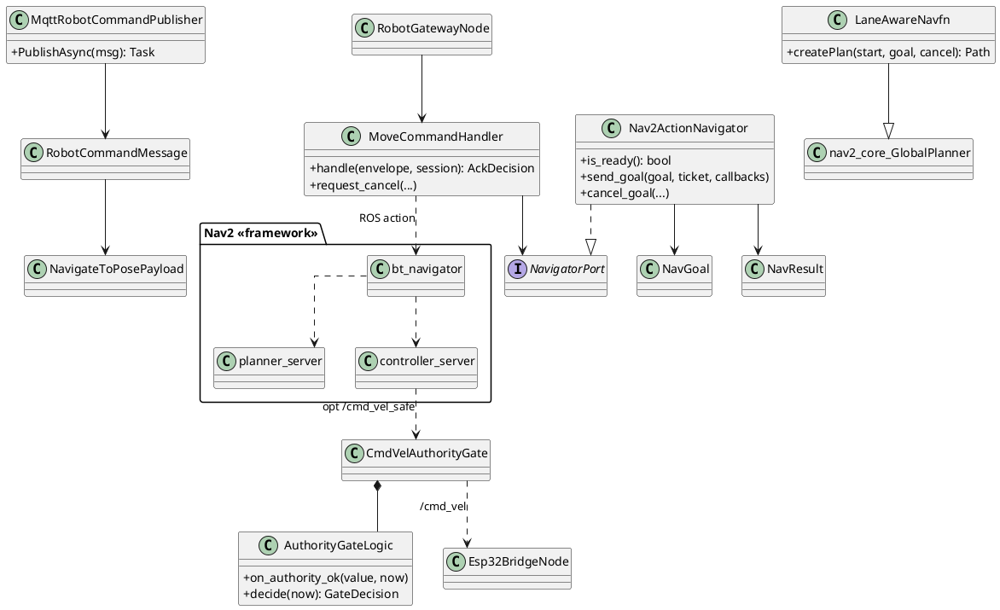
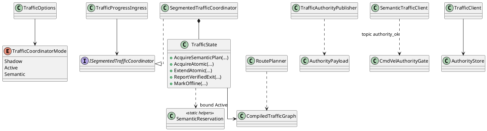

# 12 — UML Diagram Blueprints

Use orthogonal connectors for class diagrams. Label EXTERNAL Nav2 as «framework». Do not invent missing messages.

---

## 1. FE-06 Class Diagram

**Include classes:** RobotCommandMessage, NavigateToPosePayload, MqttRobotCommandPublisher, RobotGatewayNode, MoveCommandHandler, Nav2ActionNavigator, NavGoal, NavResult, LaneAwareNavfn, CmdVelAuthorityGate, Esp32BridgeNode, «framework» Nav2Stack

**Relationships:**
- Nav2ActionNavigator ..|> NavigatorPort
- MoveCommandHandler --> Nav2ActionNavigator
- RobotGatewayNode --> MoveCommandHandler
- LaneAwareNavfn --|> GlobalPlanner
- CmdVelAuthorityGate --> AuthorityGateLogic
- Publisher --> RobotCommandMessage

**Exclude:** TrafficState, SemanticReservation, full costmap layer class explosion.

---

## 2. FE-06 NavigateToPose Sequence

Participants: BackendPublisher, MQTT, RobotGatewayNode, MoveCommandHandler, Nav2ActionNavigator, bt_navigator, planner_server, controller_server, Esp32BridgeNode

Use steps from `03_FE06_SEQUENCE_TRACES.md` SQ01.  
`alt` NOT_LOCALIZED / NAV2_UNAVAILABLE / BUSY.  
`loop` FollowPath until result.

---

## 3. FE-06 Obstacle / Recovery Sequence

Participants: /scan, ObstacleLayer«framework», controller_server, BT Recovery, planner_server, MoveCommandHandler, MQTT

`alt` replan success vs ABORT → FAILED.  
Note: PathPolicyValidator not in OA diagram.

---

## 4. FE-11 Class Diagram

**Include:** TrafficOptions, TrafficCoordinatorMode, ITrafficCoordinator, TrafficCoordinator, ISegmentedTrafficCoordinator, SegmentedTrafficCoordinator, TrafficState, SemanticReservation, RoutePlanner, TrafficAuthorityPublisher, TrafficProgressIngress, AuthorityPayload, TrafficClient, SemanticTrafficClient, AuthorityStore, CmdVelAuthorityGate, CompiledTrafficGraph«Navigation»

---

## 5. FE-11 Traffic Grant Sequence (Semantic SQ01)

Participants: Nav2, SemanticTrafficClient, MQTT, RobotMqttIngress, TrafficProgressIngress, SegmentedTrafficCoordinator, TrafficState, TrafficAuthorityPublisher, CmdVelAuthorityGate, Esp32Bridge

`alt` Grant vs Queue.  
Show TTL/renew as optional notes.

---

## 6. FE-11 Two-Robot Conflict Sequence (SQ02)

Participants: RobotA Client, RobotB Client, TrafficState, Publisher, GateA, GateB

`alt` capacity wait vs deadlock reject.  
`opt` PromoteWaiters after ReportVerifiedExit.  
**Annotation required:** Unit-tested; Gazebo dual PASS not verified.

---

## 7. FE-11 Quarantine / Replan

**Replan:** new traffic_plan → AcquireSemanticPlan → occupancy reconcile → authority update → gate.  
**Offline:** HB timeout → MarkOffline → Quarantine keep occupancy → MarkOnline on HB.

Exclude inventing auto map replan deadlock solvers.

---

## What can / cannot be drawn accurately

| Diagram | Ready? |
|---|---|
| FE-06 class + SQ01 | YES from source |
| FE-06 SQ02 | YES as framework+BT; not custom OA class |
| FE-11 class + SQ01 | YES |
| FE-11 SQ02 | YES as code/unit path; must flag unverified live dual PASS |
| Unified single traffic algorithm | NO |
