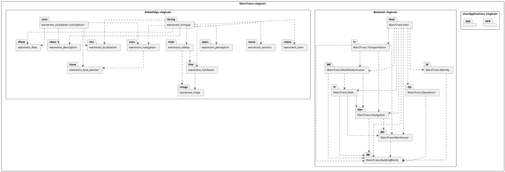
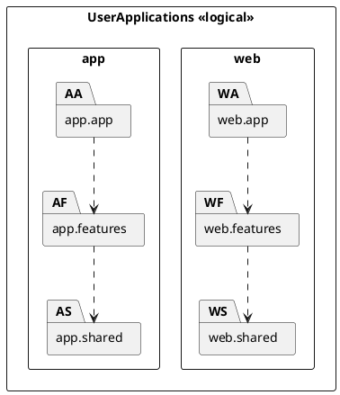
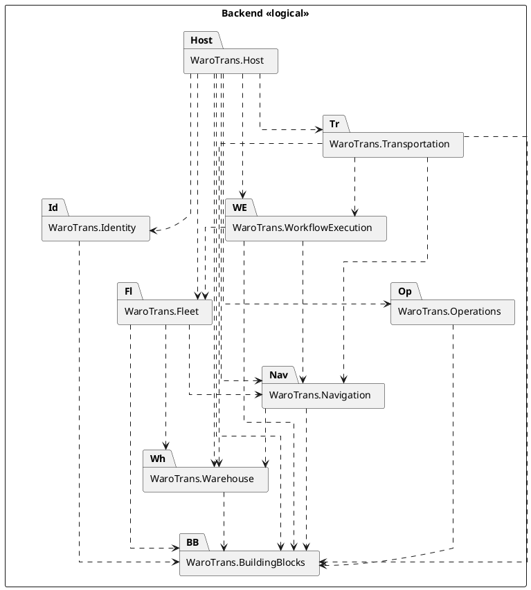
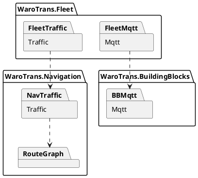
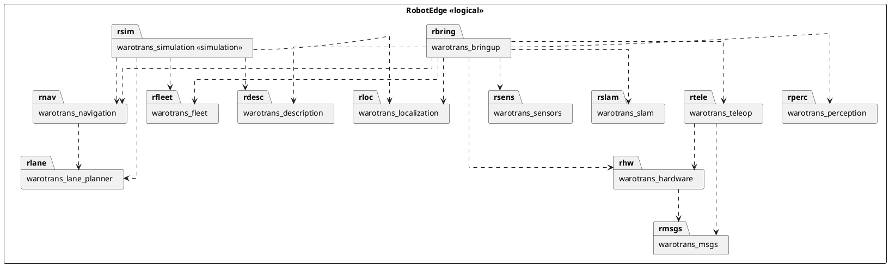

# 09 — UML Diagram Specification

**Audit date:** 2026-11-03  
**Notation:** UML Package Diagram; dashed arrows = dependencies (dependent → required); nesting = containment.  
**Line style:** orthogonal (`skinparam linetype ortho`).  
**Confidence:** PlantUML below includes **VERIFIED** compile/package dependencies only. Runtime edges are commented, not drawn as primary deps.

---

## A. Overall Package Diagram

1. **Title:** WaroTrans — Overall Package Diagram  
2. **Outer/root package:** `WaroTrans` «logical grouping»  
3. **Nested packages:** `UserApplications`, `Backend`, `RobotEdge`  
4. **Inside UserApplications:** `web`, `app`  
5. **Inside Backend:** Host, BuildingBlocks, Identity, Warehouse, Transportation, WorkflowExecution, Fleet, Navigation, Operations  
6. **Inside RobotEdge:** all 13 `warotrans_*` packages (simulation may be stereotype `simulation`)  
7. **Verified dependency arrows (Backend only on overall):** see Backend diagram; overall may omit dense ROS/frontend internals  
8. **Ambiguity:** Cross-repo MQTT/REST are runtime — do not draw as unmarked package deps

### PlantUML — Overall (structural + backend deps)

---

## B. User Applications Subsystem Package Diagram

1. **Title:** WaroTrans — User Applications Package Diagram  
2. **Outer:** `UserApplications`  
3. **Nested:** `web` {`web.app`, `web.features`, `web.shared`}, `app` {`app.app`, `app.features`, `app.shared`}  
4. **Deps:** app/shell → features → shared (both trees); no shared library between web and app  
5. **Ambiguity:** limited web cross-feature imports exist — omit from primary diagram or note as exceptions

---

## C. Backend Subsystem Package Diagram

1. **Title:** WaroTrans — Backend Package Diagram  
2. **Outer:** `Backend`  
3. **Packages:** Host, BuildingBlocks, seven modules  
4. **Deps:** ProjectReference graph only  
5. **Ambiguity:** Internal folders Traffic/RouteGraph/Mqtt are namespaces — optional nested detail diagram

### Optional Backend Traffic Detail (namespaces, not separate projects)

Evidence: Fleet ProjectReference→Navigation; Fleet MQTT uses BuildingBlocks MQTT; TrafficGraphCompiler uses RouteGraphBuilder.

---

## D. Robot Edge Subsystem Package Diagram

1. **Title:** WaroTrans — Robot Edge Package Diagram  
2. **Outer:** `RobotEdge`  
3. **Packages:** 13 ROS packages  
4. **Deps:** package.xml warotrans_* edges (+ optional annotated fleet→simulation import)  
5. **Ambiguity:** bringup declares fleet but current launches may not Include fleet.launch — keep package.xml edge; note uncertainty

---

## Evidence references

- Backend ProjectReferences: `backend/**/*.csproj`, `backend/WaroTrans.slnx`
- Frontend trees: `web/src/**`, `app/src/**`, package.json files
- ROS: `ros2_ws/src/*/package.xml`, setup.py / plugin XML
- Full edge list: `06_PACKAGE_DEPENDENCIES.csv`
- Descriptions: `08_PACKAGE_DESCRIPTIONS.md`
