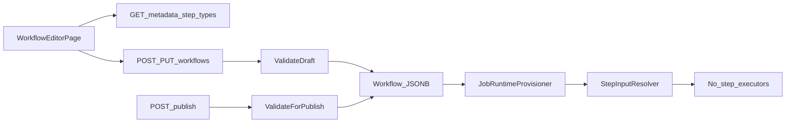

# WaroTrans Workflow Builder – Frontend vs Backend Audit

**Audit date:** 2026-10-13  
**Scope:** Admin Create / Edit Workflow Template (canonical path)  
**Mode:** Source-code audit only — no production code modified  
**Rules SoT consulted:** `rules/03-WORKFLOW-RUNTIME-RULES.md`, `rules/12-WORKFLOW-CATALOG.md`, `rules/00-PROJECT-CONTEXT.md`

---

## 1. Executive Summary

**Overall status:** PARTIALLY ALIGNED for template authoring on the canonical Admin editor; NOT READY for a real end-to-end Workflow demo (runtime executors missing).

**Biggest mismatches**

1. **Dual UI:** `/configure/workflows/*` (`WorkflowEditorPage`) is metadata-API driven and mostly aligned with backend. Map Editor embeds `WorkflowBuilderPanel` + `constants.ts` which hard-codes MOVE/HUMAN/CHECK inputs/outputs that **do not match** `StepTypeRegistry` (e.g. `speedProfile`, `confirmedContainerId`).
2. **MOVE registry inputs ≠ UI scenario / legacy FE:** Backend MOVE only accepts `robotId`, `targetEndpointId`, `purpose`, optional `commandTimeoutSeconds`. Fields `speedProfile`, `positionToleranceMeters`, `yawToleranceDegrees` are **not** in the registry.
3. **HUMAN outputs:** Backend exposes `confirmed`, `confirmedBy`, `confirmedAt`, `note`. Legacy FE/mock uses `confirmedContainerId` — **not defined**.
4. **Required UUID inputs often omitted in inbound scenario:** MOVE and PICKUP/DROPOFF_CONFIRM require `robotId`; CHECK `INVENTORY_AVAILABLE` requires `containerId` and is `ONCE_PER_JOB` (cannot use `CURRENT_MOVEMENT`).
5. **Runtime gap:** `JobRuntimeProvisioner` + `StepInputResolver` exist; no Job orchestration loop, no MOVE/HUMAN/CHECK executors, Fleet navigate is pose-based — not MOVE `ResolvedInputs`.

**Can the current UI safely create a valid Workflow?**

- **Draft save:** Yes, with weak FluentValidation (code/name only) + `ValidateDraft` (structure without required bindings).
- **Publish a correct INBOUND template as described in §11:** **No** — several bindings/fields fail `ValidateForPublish` against current registry.
- **Execute that Workflow on robots/staff:** **No** — execution layer not wired (`rules/03`).

---

## 2. Architecture Observed

```text
Admin UI (WorkflowEditorPage)
    │
    ├─ GET /api/workflow-execution/metadata/step-types
    │     ← StepTypeRegistry + OperationExecutionScopeCatalog
    │     ← CurrentMovementCatalog + SystemVariableCatalog
    │
    ├─ POST/PUT /api/workflow-execution/workflows
    │     → UpsertWorkflowRequest
    │     → WorkflowDefinitionValidator.ValidateDraft
    │     → Workflow / WorkflowTask / WorkflowStep
    │     → VariablesSchema (jsonb), Config (jsonb), InputBindings (jsonb)
    │
    └─ POST /api/workflow-execution/workflows/{id}/publish
          → ValidateForPublish (full bindings + required inputs)
          → Status = PUBLISHED

Later (not Admin Builder, but relevant):
    JobBatchPlan → JobRuntimeProvisioner
         → Job / JobTask / JobStep (ResolvedInputs = {} at provision)
         → StepInputResolver (library; no orchestration caller found)
         → MOVE/HUMAN/CHECK executors: NOT IMPLEMENTED
         → Fleet IssueNavigateCommand: X/Y/Yaw (not MOVE inputs)
```



---

## 3. Source Files Inspected

### Frontend (16 files)

| Path | Responsibility |
|------|----------------|
| `web/src/App.tsx` | Routes `/configure/workflows`, `/new`, `/:id` |
| `web/src/app/AppShell.tsx` | Nav entry “Workflows” |
| `web/src/features/workflows/workflows-list-page.tsx` | List + link to create |
| `web/src/features/workflows/workflow-editor-page.tsx` | **Canonical** create/edit/publish UI + `toUpsert` |
| `web/src/features/workflows/binding-editor.tsx` | Per-input binding selector |
| `web/src/features/workflows/workflow-defaults.ts` | Empty variable/task/step factories |
| `web/src/features/workflows/workflows.css` | Editor styles (not audited for aesthetics) |
| `web/src/features/workflows/WorkflowBuilderPanel.tsx` | **Legacy** Map Editor builder |
| `web/src/features/workflows/constants.ts` | Hardcoded step/input/output specs (legacy) |
| `web/src/features/workflows/mock.ts` | Mock workflows for Map Editor |
| `web/src/shared/api/workflows.ts` | API client |
| `web/src/shared/api/types.ts` | API DTOs for editor |
| `web/src/shared/api/contracts.ts` | Mock/UI contracts (Map Editor binding `path`) |
| `web/src/shared/api/client.ts` | `apiFetch` / `ApiError` |
| `web/src/features/maps/MapEditorPage.tsx` | Embeds `WorkflowBuilderPanel` |
| `web/src/features/workflows/WorkflowBuilderPanel.tsx` | (listed; dual-stack) |

### Backend (28 files)

| Path | Responsibility |
|------|----------------|
| `backend/.../Entities/Workflow.cs` | Aggregate + `VariablesSchema` |
| `backend/.../Entities/WorkflowTask.cs` | Task rows |
| `backend/.../Entities/WorkflowStep.cs` | Step + Config + InputBindings |
| `backend/.../Entities/Job.cs` / `JobTask.cs` / `JobStep.cs` | Runtime rows |
| `backend/.../Entities/HandoverConfirmation.cs` | Schema-only human evidence |
| `backend/.../ValueObjects/WorkflowVariableDefinition.cs` | Variable VO |
| `backend/.../ValueObjects/StepInputBinding.cs` | Binding VO |
| `backend/.../ValueObjects/WorkflowStepConfig.cs` | `OperationCode`, `InstructionText` |
| `backend/.../Enums/WorkflowDataType.cs` | Primitive types |
| `backend/.../Registry/StepTypeRegistry.cs` | Step ops / inputs / outputs SoT |
| `backend/.../Registry/StepTypeDefinitions.cs` | Record shapes + `IsAvailableAt` |
| `backend/.../Registry/CurrentMovementCatalog.cs` | CURRENT_MOVEMENT paths |
| `backend/.../Registry/SystemVariableCatalog.cs` | SYSTEM_VALUE keys |
| `backend/.../Registry/OperationExecutionScopeCatalog.cs` | Execution scopes SoT |
| `backend/.../Registry/ExecutionScope.cs` | Scope enum |
| `backend/.../Validation/WorkflowDefinitionValidator.cs` | Draft vs publish |
| `backend/.../Validation/WorkflowDataTypeCompatibility.cs` | Type parse/compat |
| `backend/.../Features/Shared/WorkflowDtos.cs` | Upsert/detail DTOs + mapping |
| `backend/.../Features/CreateWorkflow/*` | Create |
| `backend/.../Features/UpdateWorkflow/*` | Update |
| `backend/.../Features/PublishWorkflow/*` | Publish |
| `backend/.../Features/GetWorkflowMetadata/Endpoint.cs` | Metadata API |
| `backend/.../Services/JobRuntimeProvisioner.cs` | Expansion / empty ResolvedInputs |
| `backend/.../Runtime/StepInputResolver.cs` | Binding → ResolvedInputs |
| `backend/.../Runtime/CurrentMovementContext.cs` | Path resolution |
| `backend/.../Persistence/Configurations/WorkflowConfiguration.cs` | VariablesSchema jsonb |
| `backend/.../Persistence/Configurations/WorkflowStepConfiguration.cs` | Config/InputBindings jsonb |
| `backend/src/Modules/Fleet/Features/IssueNavigateCommand/Handler.cs` | Pose navigate (not MOVE inputs) |
| `backend/src/WaroTrans.BuildingBlocks/Enums/SharedEnums.cs` | `BindingSourceType`, `WorkflowVariableSource` |

### Rules (2)

| Path | Role |
|------|------|
| `rules/03-WORKFLOW-RUNTIME-RULES.md` | Authoritative runtime/template rules |
| `rules/12-WORKFLOW-CATALOG.md` | Business workflow catalog |

---

## 4. Current Backend Workflow Domain

| Concept | Persistence | Notes |
|---------|-------------|-------|
| `Workflow` | `execution.workflows` | `Code`, `VersionNo`, `Name`, `Description`, `Status`, **`VariablesSchema` jsonb** |
| `WorkflowVariableDefinition` | Inside VariablesSchema | `Key`, `Name`, `DataType`, `Source`, `IsRequired`, `DefaultValue`, `ConfiguredValue`, `Description`, `SequenceNo` |
| `WorkflowTask` | `execution.workflow_tasks` | `TaskKey`, `Name`, `SequenceNo` |
| `WorkflowStep` | `execution.workflow_steps` | `StepKey`, `Name`, `StepType`, `SequenceNo`, **`Config` jsonb**, **`InputBindings` jsonb**, timeout/retry/`OnFailure` |
| `WorkflowStepConfig` | Config jsonb | `OperationCode`, `InstructionText` |
| `StepInputBinding` | InputBindings jsonb map key → binding | `SourceType`, `SourceReference`, `OutputKey`, `ConstantValue` |

Evidence: `WorkflowConfiguration.cs`, `WorkflowStepConfiguration.cs`, value-object classes above.

---

## 5. Metadata Source of Truth

**Endpoint:** `GET /api/workflow-execution/metadata/step-types`  
**Handler:** `GetWorkflowMetadataEndpoint.MapGetWorkflowMetadata`  
**FE caller:** `fetchWorkflowMetadata()` in `web/src/shared/api/workflows.ts`

Canonical Admin editor **does call this API** and drives:

- stepTypes / operations / inputs / outputs / allowedValues  
- bindingSources, variableSources, dataTypes, failurePolicies  
- systemVariables, currentMovementFields  
- executionScope + stopActionFilter per operation (exposed on operation metadata)

Registry SoT remains **hard-coded C#** (`StepTypeRegistry`); Admin cannot invent types.

### CHECK (`operationFieldName` = `conditionCode`)

| Operation | Required inputs | Optional | Outputs |
|-----------|-----------------|----------|--------|
| ROBOT_READY | robotId UUID | — | passed, robotStatus, reason, checkedAt |
| BATTERY_MIN | robotId UUID, minimumBatteryPercent DECIMAL | — | passed, actualBatteryPercent, requiredBatteryPercent, reason, checkedAt |
| ENDPOINT_AVAILABLE | endpointId UUID | — | passed, endpointStatus, reason, checkedAt |
| LOAD_STATE | robotId UUID, expectedLoadState STRING {EMPTY,LOADED} | containerId UUID | passed, actualLoadState, reason, checkedAt |
| REQUEST_ACTIVE | transportRequestId UUID | — | passed, requestStatus, reason, checkedAt |
| INVENTORY_AVAILABLE | **containerId UUID** | — | passed, reason, checkedAt |

### MOVE (`operationFieldName` = `purpose`)

All purposes `PICKUP|DROPOFF|PARK|CHARGE|TRANSIT` share:

| Required | Optional | Outputs |
|----------|----------|---------|
| robotId UUID, targetEndpointId UUID, purpose STRING (allowed = MovePurpose names) | commandTimeoutSeconds INTEGER | navigationResult, arrivedEndpointId, startedAt, completedAt, failureReason |

**Not in registry:** `speedProfile`, `positionToleranceMeters`, `yawToleranceDegrees`, `allowReplan`, `timeout` (as named in legacy FE).

### HUMAN_INTERACTION (`operationFieldName` = `actionCode`)

PICKUP_CONFIRM / DROPOFF_CONFIRM required: `robotId`, `containerId`, `endpointId` (all UUID).  
Outputs (common): `confirmed` BOOL, `confirmedBy` UUID, `confirmedAt` DATETIME, `note` STRING.  
**Not in registry:** `confirmedContainerId`, `confirmationId`, `result`, `details`.

### WAIT (`operationFieldName` = `waitMode`)

DURATION / EVENT / ROBOT_STATE — see `StepTypeRegistry.BuildWait` (inspected via agent + registry file).

---

## 6. Variable Audit

### Sources (backend enum `WorkflowVariableSource`)

| Source | Publish rules (`ValidateForPublish`) | Canonical FE behavior |
|--------|--------------------------------------|------------------------|
| ADMIN_INPUT | `configuredValue` required + type-parse | Text input → `configuredValue` (casts INT/DECIMAL/BOOLEAN) |
| STAFF_INPUT | Must **not** have configuredValue | No value field |
| SYSTEM_VALUE | Key must exist in `SystemVariableCatalog`; type must match | Dropdown sets `key` + `dataType` from catalog |

Evidence: `WorkflowDefinitionValidator.ValidateVariables`; `workflow-editor-page.tsx` variable fieldset.

### Data types (backend `WorkflowDataType`)

`STRING | INTEGER | DECIMAL | BOOLEAN | UUID | DATETIME` only.  
No `ENDPOINT`, `CONTAINER`, `STORAGE_LOCATION`, `INT`, `BOOL` resource/semantic types.

### SYSTEM catalog keys

`assignedRobotId`, `jobId`, `transportRequestId`, `currentUserId` (all UUID) — `SystemVariableCatalog.cs`.

### Legacy FE drift

`constants.ts` / Map Editor use different type names and a `value` field (not `configuredValue`).

---

## 7. Binding Source Audit

Backend enum: `BindingSourceType` = `WORKFLOW_VAR | CURRENT_MOVEMENT | STEP_OUTPUT | CONSTANT`  
(`SharedEnums.cs`). FE canonical options = `metadata.bindingSources` (same enum names).

| Source | Binding JSON shape | Validator | Resolver |
|--------|-------------------|-----------|----------|
| WORKFLOW_VAR | `{ sourceType, sourceReference: varKey }` | Variable exists + type compatible | `variableContext[key]` |
| CURRENT_MOVEMENT | `{ sourceType, sourceReference: path }` | Catalog path + type + requiredCapable + **scope availability** | `CurrentMovementContext.TryGet` |
| STEP_OUTPUT | `{ sourceType, sourceReference: stepKey, outputKey }` | Earlier step by sequence + output exists + type | `earlierStepOutputs[stepKey][outputKey]` |
| CONSTANT | `{ sourceType, constantValue }` | Parse + AllowedValues | Literal |

Canonical FE: `binding-editor.tsx`.  
Legacy FE: single `path` string in `contracts.InputBinding` — **different model**.

---

## 8. CURRENT_MOVEMENT Audit

### Catalog (backend SoT — full list)

| Path | DataType | RequiredCapable | Available at |
|------|----------|-----------------|--------------|
| containerId | UUID | true | PER_CONTAINER_AT_STOP only (not STOP/JOB) |
| transportRequestDetailId | UUID | true | PER_CONTAINER_AT_STOP |
| jobContainerId | UUID | true | PER_CONTAINER_AT_STOP |
| source.endpointId | UUID | true | STOP+PICKUP; also PER_CONTAINER |
| source.storageLocationId | UUID | false | PER_CONTAINER |
| source.levelNo | INTEGER | false | PER_CONTAINER |
| destination.endpointId | UUID | true | STOP+DROPOFF; also PER_CONTAINER |
| destination.storageLocationId | UUID | false | PER_CONTAINER |
| destination.levelNo | INTEGER | false | PER_CONTAINER |

Evidence: `CurrentMovementCatalog.cs`, `CurrentMovementFieldDefinition.IsAvailableAt`.

**ONCE_PER_JOB:** all CURRENT_MOVEMENT bindings rejected (`WorkflowDefinitionValidator`).

### Frontend

Canonical editor lists `metadata.currentMovementFields` (API).  
Legacy hardcodes `CURRENT_MOVEMENT_PATHS` in `constants.ts`.

**UX note:** UI does not explain that CURRENT_MOVEMENT is provisioned from TransportRequestDetail / JobTask context — Admin may think it is a free-typed Staff field. Metadata descriptions help; no explicit “Staff must not enter this” banner.

---

## 9. Execution Scope Audit

**SoT:** `OperationExecutionScopeCatalog` — **not** stored on `WorkflowStep`.

| Operation | Scope | Stop filter |
|-----------|-------|-------------|
| CHECK INVENTORY_AVAILABLE (and most CHECK) | ONCE_PER_JOB | — |
| CHECK ENDPOINT_AVAILABLE | ONCE_PER_STOP | inherit task affinity |
| MOVE PICKUP / DROPOFF | ONCE_PER_STOP | PICKUP / DROPOFF |
| MOVE PARK/CHARGE/TRANSIT | ONCE_PER_JOB | — |
| HUMAN PICKUP_CONFIRM | PER_CONTAINER_AT_STOP | PICKUP |
| HUMAN DROPOFF_CONFIRM | PER_CONTAINER_AT_STOP | DROPOFF |
| WAIT * | ONCE_PER_JOB | — |

**UI:** Admin does **not** choose scope. Metadata exposes `executionScope` / `stopActionFilter` on operations; editor does not prominently teach scope rules when picking CURRENT_MOVEMENT paths (FE only filters by dataType, not by scope availability).

**Effective scopes for named inbound steps (§11):**

| Step | Assumed operation | Effective scope |
|------|-------------------|-----------------|
| MOVE_TO_INBOUND | MOVE/PICKUP | ONCE_PER_STOP (PICKUP) |
| PICKUP | HUMAN/PICKUP_CONFIRM | PER_CONTAINER_AT_STOP |
| MOVE_TO_SHELF | MOVE/DROPOFF | ONCE_PER_STOP (DROPOFF) |
| CHECK | CHECK/INVENTORY_AVAILABLE | ONCE_PER_JOB |
| DROPOFF | HUMAN/DROPOFF_CONFIRM | PER_CONTAINER_AT_STOP |

---

## 10. UI → API → Domain Mapping

### Example Create/Save payload (canonical serializer)

Shape produced by `toUpsert` / `WorkflowUpsert` → `UpsertWorkflowRequest`:

```json
{
  "code": "INBOUND_WF",
  "name": "Inbound putaway",
  "description": null,
  "variables": [
    {
      "key": "speed",
      "name": "speed",
      "dataType": "STRING",
      "source": "ADMIN_INPUT",
      "isRequired": true,
      "configuredValue": "30",
      "sequenceNo": 1
    }
  ],
  "tasks": [
    {
      "taskKey": "COME_TO_INBOUND",
      "name": "Come to inbound pos",
      "sequenceNo": 1,
      "steps": [
        {
          "stepKey": "MOVE_TO_INBOUND",
          "name": "MOVE_TO_INBOUND",
          "stepType": "MOVE",
          "sequenceNo": 1,
          "operationCode": "PICKUP",
          "instructionText": null,
          "inputBindings": {
            "targetEndpointId": {
              "sourceType": "CURRENT_MOVEMENT",
              "sourceReference": "source.endpointId"
            },
            "robotId": {
              "sourceType": "WORKFLOW_VAR",
              "sourceReference": "assignedRobotId"
            },
            "purpose": {
              "sourceType": "CONSTANT",
              "constantValue": "PICKUP"
            }
          },
          "timeoutSeconds": 300,
          "maxAttempts": 1,
          "retryBackoffSeconds": 0,
          "onFailure": "FAIL_JOB"
        }
      ]
    }
  ]
}
```

*(Illustrative corrected shape for documentation — the §11 scenario as stated is incomplete/invalid; see §11.)*

### Field mapping table

| Frontend field | JSON field | Backend DTO | Domain | Persistence |
|----------------|------------|-------------|--------|-------------|
| draft.code | code | UpsertWorkflowRequest.Code | Workflow.Code | column |
| draft.name | name | Name | Workflow.Name | column |
| draft.description | description | Description | Workflow.Description | column |
| draft.variables[] | variables | List\<WorkflowVariableDefinition\> | Workflow.VariablesSchema | **jsonb** |
| variable.configuredValue | configuredValue | ConfiguredValue | same | inside VariablesSchema |
| task.taskKey/name/sequenceNo | tasks[] | UpsertWorkflowTaskRequest | WorkflowTask | columns |
| step.stepKey/name/stepType/sequenceNo | steps[] | UpsertWorkflowStepRequest | WorkflowStep | columns |
| step.operationCode | operationCode | → Config.OperationCode | WorkflowStepConfig | **Config jsonb** |
| step.instructionText | instructionText | → Config.InstructionText | WorkflowStepConfig | **Config jsonb** |
| step.inputBindings | inputBindings | Dictionary | WorkflowStep.InputBindings | **jsonb** |
| binding.sourceType | sourceType | StepInputBinding.SourceType | same | inside InputBindings |
| binding.sourceReference | sourceReference | SourceReference | same | |
| binding.outputKey | outputKey | OutputKey | same | |
| binding.constantValue | constantValue | ConstantValue | same | |
| step.timeoutSeconds / maxAttempts / retryBackoffSeconds / onFailure | same | UpsertWorkflowStepRequest | WorkflowStep columns | columns |

Evidence: `types.ts`, `WorkflowDtos.cs` (`ApplyDefinition`), EF configurations.

**Not sent as free fields:** Workflow.Status (server-controlled), VersionNo (create/version endpoints).

---

## 11. INBOUND Workflow Configuration Audit

Assumptions when mapping UI wording → backend:

- CHECK “checkType = INVENTORY_AVAILABLE” means `operationCode = INVENTORY_AVAILABLE` (not an input named `checkType`).
- HUMAN “interactionType = PICKUP_CONFIRM” means `operationCode = PICKUP_CONFIRM`.
- MOVE_TO_INBOUND / MOVE_TO_SHELF use operations PICKUP / DROPOFF respectively unless stated otherwise.

### Variables

| Variable | Verdict | Why |
|----------|---------|-----|
| speed STRING ADMIN_INPUT configuredValue="30" | ⚠️ VALID BUT QUESTIONABLE | Publish-valid as ADMIN_INPUT STRING. **No MOVE input named speedProfile** in registry — unused for MOVE unless bound to a STRING input that exists (none on MOVE). |
| pos_tolerance DECIMAL ADMIN_INPUT =15 | ⚠️ VALID BUT QUESTIONABLE | Same — no `positionToleranceMeters` input on MOVE. |
| yaw_tolerance DECIMAL ADMIN_INPUT =90 | ⚠️ VALID BUT QUESTIONABLE | Same — no `yawToleranceDegrees` input on MOVE. |

### Task 1 – Come to inbound pos

| Binding | Verdict | Why |
|---------|---------|-----|
| MOVE targetEndpointId ← CURRENT_MOVEMENT.source.endpointId | ✅ VALID | MOVE PICKUP is ONCE_PER_STOP; `source.endpointId` available at PICKUP stop; UUID↔UUID. |
| MOVE purpose | ❓ CANNOT VERIFY in scenario | Scenario omits purpose binding; registry **requires** purpose. Without CONSTANT/WORKFLOW_VAR → ❌ on publish. |
| MOVE robotId | ❌ INVALID (missing) | Required UUID; scenario does not bind. Typical fix: SYSTEM_VALUE var `assignedRobotId` → WORKFLOW_VAR. |
| MOVE speedProfile / tolerances | ❌ INVALID | Not registry inputs; unknown binding keys fail publish when full validation runs. |
| HUMAN interactionType CONSTANT.PICKUP_CONFIRM | ⚠️ QUESTIONABLE naming | Correct as **operationCode**, not an input. If FE sends input `interactionType`, ❌ unknown input. |
| HUMAN containerId ← CURRENT_MOVEMENT.containerId | ✅ VALID | PICKUP_CONFIRM is PER_CONTAINER_AT_STOP; containerId available. |
| HUMAN endpointId ← CURRENT_MOVEMENT.source.endpointId | ✅ VALID | Same scope; UUID. |
| HUMAN robotId | ❌ INVALID (missing) | Required. |

### Task 2 – Transfer goods to shelf

| Binding | Verdict | Why |
|---------|---------|-----|
| MOVE targetEndpointId ← destination.endpointId | ✅ VALID | DROPOFF stop scope. |
| purpose ← CONSTANT.DROPOFF | ✅ VALID | Allowed value; required. |
| speedProfile ← WORKFLOW_VAR.speed | ❌ INVALID | Input does not exist on MOVE. |
| positionToleranceMeters ← WORKFLOW_VAR.pos_tolerance | ❌ INVALID | Input does not exist. |
| yawToleranceDegrees ← WORKFLOW_VAR.yaw_tolerance | ❌ INVALID | Input does not exist. |
| robotId | ❌ INVALID (missing) | Required. |
| CHECK checkType CONSTANT.INVENTORY_AVAILABLE | ⚠️ naming | Must be operationCode. |
| CHECK with only checkType / no containerId | ❌ INVALID | Required `containerId`. Also CHECK is ONCE_PER_JOB → **cannot** bind CURRENT_MOVEMENT for containerId. |
| HUMAN DROPOFF containerId ← STEP_OUTPUT HUMAN_INTERACTION_2.confirmedContainerId | ❌ INVALID | Output `confirmedContainerId` **not** in registry. Outputs are `confirmed`, `confirmedBy`, `confirmedAt`, `note`. |
| HUMAN endpointId ← destination.endpointId | ✅ VALID | PER_CONTAINER DROPOFF. |
| HUMAN robotId | ❌ INVALID (missing) | Required. |

**Recommendation (documentation only):** Prefer `containerId ← CURRENT_MOVEMENT.containerId` on DROPOFF_CONFIRM rather than STEP_OUTPUT of a non-existent confirmedContainerId.

---

## 12. MOVE End-to-End Trace

| Stage | Status | Evidence |
|-------|--------|----------|
| Workflow Builder UI | Canonical lists MOVE inputs from metadata | `workflow-editor-page.tsx` + metadata API |
| Create/Update request | Persist bindings under InputBindings jsonb | `WorkflowDtos.ApplyDefinition` |
| Publish validation | Requires all required inputs bound; rejects unknown CURRENT_MOVEMENT/types | `WorkflowDefinitionValidator` |
| JobRuntimeProvisioner | Creates JobSteps; **ResolvedInputs = empty dict** | `NewJobStep` in `JobRuntimeProvisioner.cs` |
| StepInputResolver | Can resolve MOVE bindings when called | `StepInputResolver.cs` |
| MOVE executor | **NOT FOUND** | No consumer of ResolvedInputs for navigation |
| Fleet | `IssueNavigateCommand` uses X,Y,Yaw (+ optional JobStepId for lifecycle) | `IssueNavigateCommand/Handler.cs` |
| MQTT robot contract from MOVE inputs | **NOT VERIFIED / not wired** | Aligns with `rules/03` “no robot MOVE bridge yet” |

### Per MOVE field

| Field | Admin-configable? | Consumed at runtime? |
|-------|-------------------|----------------------|
| robotId | Yes (typically WORKFLOW_VAR SYSTEM assignedRobotId) | Resolver yes; executor no |
| targetEndpointId | Yes (CURRENT_MOVEMENT / VAR / CONSTANT) | Resolver yes; executor no |
| purpose | Yes (CONSTANT usually) | Resolver yes; executor no |
| commandTimeoutSeconds | Optional | Resolver yes; executor no |
| speedProfile / positionTolerance / yawTolerance | **Only in legacy FE** | Not in registry → not persisted as valid MOVE inputs on publish |

---

## 13. CHECK Audit (`INVENTORY_AVAILABLE`)

| Question | Answer | Evidence |
|----------|--------|----------|
| Required inputs | `containerId` UUID only | `StepTypeRegistry` INVENTORY_AVAILABLE |
| Optional inputs | none | same |
| productId / quantity | **Not supported** (V1 container-level) | registry + rules/03 |
| Operation vs input | Operation selected via `operationCode` / metadata `conditionCode`; **not** a separate `checkType` input | `StepTypeDefinition.OperationFieldName`, Config.OperationCode |
| UI-only checkType CONSTANT | Legacy `constants.ts` INPUT_SPECS; **diverges** from canonical editor | `constants.ts` |
| Publish with only operation, no containerId | **Fails** ValidateForPublish | required inputs must be bound |
| CURRENT_MOVEMENT.containerId on this CHECK | **Fails** — step is ONCE_PER_JOB | `OperationExecutionScopeCatalog` + validator |
| Executor | **NOT IMPLEMENTED** | no CHECK executor found |

---

## 14. HUMAN_INTERACTION Audit

### PICKUP_CONFIRM / DROPOFF_CONFIRM

| | |
|--|--|
| Required inputs | robotId, containerId, endpointId (UUID) |
| Optional | none for these two ops |
| Outputs | confirmed, confirmedBy, confirmedAt, note |
| Template/metadata | Implemented |
| Provision expansion | PER_CONTAINER_AT_STOP | `OperationExecutionScopeCatalog` |
| HumanTask entity / confirm API / executor | **Absent** |
| HandoverConfirmation | EF entity exists — **schema only** |

Legacy FE outputs (`confirmationId`, `confirmedContainerId`, …) are **misleading** relative to backend.

---

## 15. STEP_OUTPUT Multi-container Risk

| Aspect | Current implementation | Rating |
|--------|------------------------|--------|
| Publish validation | Requires earlier stepKey by task/step sequence; output must exist on source operation | SAFE for template graph |
| FE option list | `earlierSteps()` by task/step index; keys = `step.stepKey` | SAFE for authoring |
| Runtime resolution | `earlierStepOutputs[stepKey][outputKey]` | AMBIGUOUS under expansion |
| Provisioner expansion | Multiple JobSteps can be created from one HUMAN PER_CONTAINER template step | UNSAFE / AMBIGUOUS if keyed only by Workflow StepKey |
| Orchestration caller | No Job loop found that builds earlierStepOutputs and calls StepInputResolver | NOT IMPLEMENTED |
| Scenario DROPOFF ← confirmedContainerId | Output key invalid | INVALID |

**Evidence:** `StepInputResolver` STEP_OUTPUT branch; `JobRuntimeProvisioner` expansion; absence of executor loop.

**Documentation recommendation:** Prefer `CURRENT_MOVEMENT.containerId` for container identity across confirm steps (same movement context), rather than STEP_OUTPUT of confirm outputs that do not include container id.

---

## 16. Publish Validation

| Layer | Draft | Publish |
|-------|-------|---------|
| FluentValidation | Code/Name required + length | Same on update |
| `ValidateDraft` | Structure, keys, enums; **skips** ADMIN configuredValue, SYSTEM catalog, operation registry, required bindings | — |
| `ValidateForPublish` | — | ADMIN configuredValue; STAFF no configured; SYSTEM catalog; operationCode registered + scope; stop affinity; **all required inputs bound**; binding validity; ≥1 task |
| Frontend | Displays server errors; almost no client schema validation | Same |

**Frontend allows draft that publish will reject:** empty/missing required bindings, ADMIN without configuredValue, SYSTEM free-text key (canonical FE constrains via dropdown), CURRENT_MOVEMENT incompatible with step scope (FE does not filter by scope).

**Frontend legacy forbids / invents things backend does not support:** ENDPOINT/CONTAINER types, speedProfile inputs, confirmedContainerId outputs.

---

## 17. Frontend/Backend Drift Matrix

| Area | Frontend (canonical) | Frontend (legacy Map) | Backend SoT | Match? | Severity | Notes |
|------|----------------------|-----------------------|-------------|--------|----------|-------|
| VariableSource | metadata | hardcoded | enum | OK / drift | LOW / HIGH | Dual UI |
| VariableDataType | metadata 6 types | ENDPOINT/CONTAINER/INT/BOOL | WorkflowDataType | OK / drift | HIGH (legacy) | |
| ADMIN configuredValue | yes | uses `value` | ConfiguredValue | OK / drift | MEDIUM | |
| STAFF_INPUT | no value UI | disabled value | no configuredValue | OK | OK | |
| SYSTEM_VALUE | catalog select | free/limited | SystemVariableCatalog | OK / drift | MEDIUM | |
| StepTypes | metadata | SUPPORTED_STEP_TYPES | StepTypeRegistry | OK / partial | MEDIUM | |
| Operations | metadata | partial hardcode | registry | OK / drift | HIGH | |
| Required inputs | metadata | INPUT_SPECS wrong | registry | OK / drift | BLOCKER (legacy) | |
| Optional inputs | metadata | invents MOVE tolerances | registry | OK / drift | HIGH | |
| Outputs | metadata | confirmedContainerId etc. | registry | OK / drift | BLOCKER (legacy + scenario) | |
| allowedValues | metadata | local lists | registry | OK / drift | MEDIUM | |
| BindingSource | metadata | hardcoded | BindingSourceType | OK | OK | |
| WORKFLOW_VAR | yes | path model | validator | OK / model drift | MEDIUM | |
| CURRENT_MOVEMENT | metadata fields | hardcoded paths | catalog | OK / drift | HIGH | FE no scope filter |
| STEP_OUTPUT | earlier steps | mock paths | validator | OK | HIGH runtime | multi-container |
| CONSTANT | yes | yes | validator | OK | OK | |
| executionScope | exposed in metadata, not edited | unknown | OperationExecutionScopeCatalog | partial | HIGH | invisible to Admin |
| timeout/retry/onFailure | editable | limited | WorkflowStep columns | OK | LOW | |
| instructionText | HUMAN only gate | — | Config | OK | LOW | |

---

## 18. Findings

### F-01 – Dual Workflow UIs with incompatible schemas

**Severity:** BLOCKER  
**Component:** Frontend (`WorkflowEditorPage` vs `WorkflowBuilderPanel`/`constants.ts`)  
**Source evidence:** `web/src/App.tsx` routes; `MapEditorPage.tsx` embeds panel; `constants.ts` INPUT_SPECS/OUTPUT_SPECS vs `StepTypeRegistry.cs`  
**Current behavior:** Admins may learn MOVE/HUMAN fields from Map mock that backend rejects.  
**Expected:** Single authoring surface driven by metadata API.  
**Impact:** Invalid templates; confusion in reviews/demos.  
**Recommended direction:** Remove or clearly label Map Editor workflow mock as non-API; delete divergent INPUT/OUTPUT specs or generate from metadata.

### F-02 – MOVE tolerance/speed fields not in backend registry

**Severity:** BLOCKER (for scenarios that rely on them)  
**Component:** Legacy FE + inbound scenario; Backend registry  
**Source evidence:** `StepTypeRegistry.BuildMove`; `constants.ts` lines with speedProfile/positionToleranceMeters/yawToleranceDegrees  
**Current behavior:** Canonical editor will not offer these inputs; binding them fails publish.  
**Expected:** Only robotId/targetEndpointId/purpose(/commandTimeoutSeconds).  
**Impact:** INBOUND scenario as written cannot publish.  
**Recommended direction:** Either extend registry+robot contract, or remove fields from product UI/docs.

### F-03 – HUMAN output `confirmedContainerId` does not exist

**Severity:** BLOCKER  
**Component:** Legacy mock + inbound STEP_OUTPUT scenario  
**Source evidence:** `StepTypeRegistry.BuildHumanInteraction` commonOutputs; `mock.ts` / `constants.ts` OUTPUT_SPECS  
**Current behavior:** STEP_OUTPUT to confirmedContainerId fails ValidateForPublish.  
**Expected:** Outputs confirmed/confirmedBy/confirmedAt/note; container identity via CURRENT_MOVEMENT.containerId.  
**Impact:** Cannot chain DROPOFF containerId from confirm output as described.  
**Recommended direction:** Bind DROPOFF containerId from CURRENT_MOVEMENT; do not invent outputs.

### F-04 – Required `robotId` omitted in inbound scenario for MOVE and HUMAN

**Severity:** BLOCKER  
**Component:** Template scenario / UI guidance  
**Source evidence:** MOVE and PICKUP_CONFIRM/DROPOFF_CONFIRM Inputs in `StepTypeRegistry`  
**Current behavior:** Publish fails without robotId bindings.  
**Expected:** Bind WORKFLOW_VAR of SYSTEM_VALUE `assignedRobotId` (or equivalent).  
**Impact:** Cannot publish complete pick/move/drop templates.  
**Recommended direction:** Document SYSTEM_VALUE pattern; optionally FE default binding for robotId.

### F-05 – CHECK INVENTORY_AVAILABLE missing containerId and scope conflict with CURRENT_MOVEMENT

**Severity:** BLOCKER  
**Component:** CHECK registry + scope catalog + scenario  
**Source evidence:** `StepTypeRegistry` INVENTORY_AVAILABLE; `OperationExecutionScopeCatalog` → ONCE_PER_JOB; validator rejects CURRENT_MOVEMENT on ONCE_PER_JOB  
**Current behavior:** Operation-only CHECK fails publish; CURRENT_MOVEMENT.containerId illegal on this CHECK.  
**Expected:** Bound containerId from WORKFLOW_VAR/CONSTANT/STEP_OUTPUT (UUID), or rethink scope if inventory must be per-container.  
**Impact:** Inventory guard as typically imagined cannot use movement context.  
**Recommended direction:** Architecture decision on scope vs input source for inventory checks.

### F-06 – No MOVE/HUMAN/CHECK runtime executors

**Severity:** HIGH  
**Component:** WorkflowExecution runtime / Fleet  
**Source evidence:** `rules/03`; `JobRuntimeProvisioner.NewJobStep` empty ResolvedInputs; no executor types; Fleet pose navigate  
**Current behavior:** Templates can publish; Jobs can provision; steps do not execute domain ops.  
**Expected (product):** Executors consume ResolvedInputs.  
**Impact:** Demo of real robot/staff confirmation blocked.  
**Recommended direction:** Implement orchestration loop + executors; bridge MOVE → Fleet.

### F-07 – FE BindingEditor does not filter CURRENT_MOVEMENT by execution scope

**Severity:** HIGH  
**Component:** `binding-editor.tsx`  
**Source evidence:** filters only `compatible(dataType)`; backend `IsAvailableAt` + ONCE_PER_JOB ban  
**Current behavior:** Admin can select paths that publish rejects.  
**Expected:** Options filtered by operation scope (metadata already has executionScope).  
**Impact:** Frustrating publish errors.  
**Recommended direction:** Filter movement fields using metadata.executionScope + stopActionFilter.

### F-08 – STEP_OUTPUT under PER_CONTAINER expansion is ambiguous

**Severity:** HIGH  
**Component:** Provisioner + StepInputResolver  
**Source evidence:** expansion creates multiple JobSteps; resolver keys by Workflow stepKey; no orchestrator  
**Current behavior:** NOT IMPLEMENTED at runtime; ambiguous if keyed only by stepKey.  
**Expected:** Clear instance identity (JobStep id) for outputs.  
**Impact:** Multi-container confirm → later step chaining unsafe.  
**Recommended direction:** Prefer CURRENT_MOVEMENT for container identity; design output map keyed by JobStep.

### F-09 – Draft validation much weaker than publish

**Severity:** MEDIUM  
**Component:** `WorkflowDefinitionValidator`  
**Source evidence:** `ValidateDraft` vs `ValidateForPublish` `full` flag  
**Current behavior:** Incomplete drafts save; publish surfaces many errors late.  
**Expected:** Product choice — either OK for drafts or progressive validation in UI.  
**Impact:** Admin surprise at publish.  
**Recommended direction:** Surface publish-level checks in UI before publish click.

### F-10 – Execution scope invisible in Admin UX

**Severity:** MEDIUM  
**Component:** WorkflowEditorPage  
**Source evidence:** metadata includes executionScope; UI does not explain expansion semantics  
**Current behavior:** Scope is backend-only policy.  
**Expected:** Admin understands once-per-job vs per-container implications.  
**Impact:** Mis-bound CURRENT_MOVEMENT / wrong mental model.  
**Recommended direction:** Show scope badge on each step from metadata.

### F-11 – Legacy type system (ENDPOINT/CONTAINER)

**Severity:** MEDIUM  
**Component:** `constants.ts` / `contracts.ts`  
**Source evidence:** INPUT_SPECS types vs `WorkflowDataType`  
**Current behavior:** Mock UI implies resource types backend does not have.  
**Expected:** UUID + semantic description only.  
**Impact:** Drift and false confidence.  
**Recommended direction:** Delete or regenerate from metadata.

### F-12 – Frontend almost no client-side validation

**Severity:** LOW  
**Component:** `workflow-editor-page.tsx`  
**Source evidence:** relies on ApiError display  
**Current behavior:** Empty code can be attempted until server rejects.  
**Expected:** Optional UX improvement.  
**Impact:** Extra round-trips.  
**Recommended direction:** Mirror FluentValidation + required bindings client-side.

---

## 19. Questions Requiring Architecture Decision

1. Should MOVE eventually accept `speedProfile` / tolerances as first-class registry inputs and robot command fields, or remain out of Workflow forever?
2. Should `INVENTORY_AVAILABLE` stay `ONCE_PER_JOB`, and if so what is the approved binding for `containerId` (STAFF/ADMIN var vs STEP_OUTPUT)?
3. Should HUMAN confirm outputs include `confirmedContainerId`, or is CURRENT_MOVEMENT always the container identity channel?
4. How should STEP_OUTPUT resolve under PER_CONTAINER expansion (JobStep-id map vs forbidding STEP_OUTPUT across expanded siblings)?
5. When is `assignedRobotId` populated relative to first MOVE — before provision, at assignment, or mid-job?
6. Should Map Editor workflow UI be removed, or upgraded to the same metadata API as Admin editor?

---

## 20. Suggested Fix Order

### P0 – must fix before real Workflow demo

1. Treat **canonical Admin editor + metadata API** as the only authoring path; quarantine legacy builder (F-01).  
2. Correct template recipes: bind **robotId**, **purpose**, **containerId** per registry; remove non-existent MOVE/HUMAN fields from docs/scenarios (F-02, F-03, F-04).  
3. Redesign CHECK inventory binding/scope story (F-05).  
4. Implement Job orchestration + MOVE/HUMAN/CHECK executors or explicitly demo “template-only” (F-06).

### P1 – should fix

1. Filter CURRENT_MOVEMENT options by execution scope in BindingEditor (F-07).  
2. Define STEP_OUTPUT identity under multi-container expansion (F-08).  
3. Show execution scope on steps (F-10).  
4. Stronger pre-publish validation UX (F-09).

### P2 – UX/cleanup

1. Delete divergent `constants.ts` INPUT/OUTPUT specs or codegen from metadata (F-11).  
2. Light client-side required-field checks (F-12).  
3. Clarify CURRENT_MOVEMENT as provisioned context (not Staff free input) in UI copy.

---

## Appendix A – File inspection counts

| Layer | Files inspected |
|-------|-----------------|
| Frontend | 16 |
| Backend | 28 |
| Rules | 2 |
| **Total** | **46** |

## Appendix B – Finding severity tally

| Severity | Count |
|----------|-------|
| BLOCKER | 5 (F-01 … F-05) |
| HIGH | 3 (F-06 … F-08) |
| MEDIUM | 3 (F-09 … F-11) |
| LOW | 1 (F-12) |

## Appendix C – Confirmation

**No production code was modified for this audit.**  
Only documentation added: `docs/audits/workflow-builder-frontend-backend-audit.md`.
